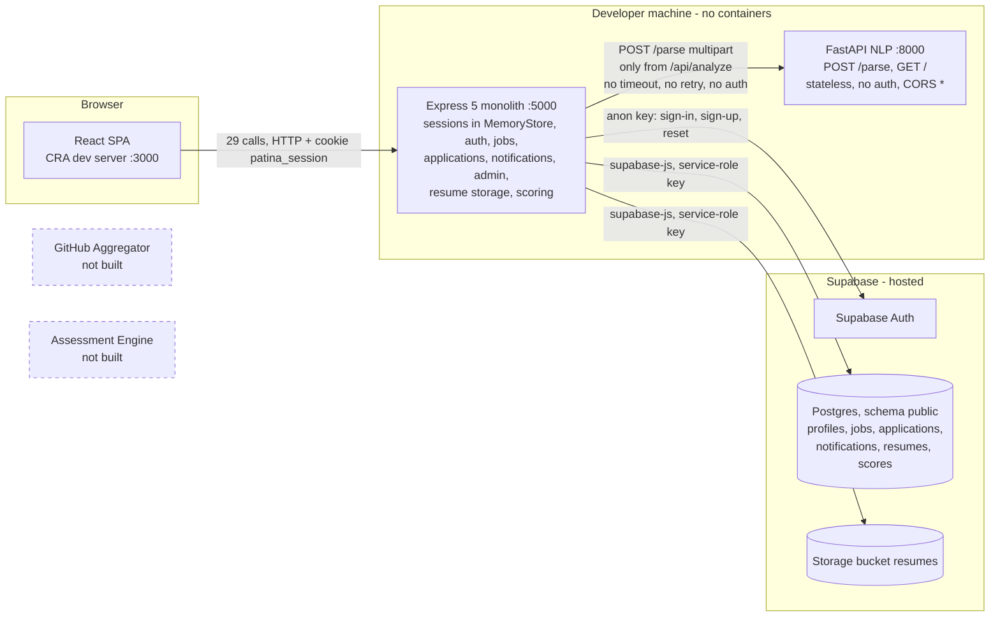
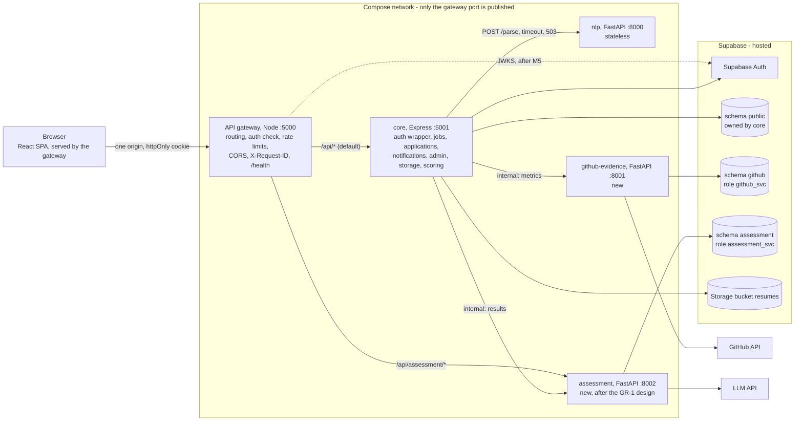

# ARCHITECTURE.md: how Patina is built, how it should be built, and how we get there

Written for guide-review item GR-2 ("identify the API gateway and verify the
system follows the microservices architecture claimed in the SRS; fix it if it
doesn't"). Task: T-0009.

Verified at commit: `8e8e498` (branch `Anthony_V3`; application code identical to `2e87d44`).

**How to read it:**
- Every as-is claim cites `file:line` at that commit, or a probe result `P-n`
  (Appendix A; re-run with `node tests/arch/nlp-outage-probe.mjs`).
- `node tests/docs/check-trackers.mjs` (the `docs` suite) fails if a cite points
  at a missing file or a line past its end. It does not prove that the cited line
  still says the same thing, so re-read cites after the code changes.
- §4 and §5 are a **proposal**. Each migration step is its own task with its own spec.

---

## 0. Answer for the guide

1. We don't have an API gateway yet; our Express server is currently the entry point and the application itself. The browser calls only Express (port 5000). Express holds the login sessions, jobs, applications, resume storage and scoring, and does all access to our Supabase Postgres database.
2. Of the three Python services we designed, one runs today: a stateless FastAPI NLP service (port 8000) that Express calls over HTTP to parse and match resumes. The GitHub evidence service and the assessment engine are not built yet.
3. So today we are a monolith with one extracted NLP microservice, not yet a microservices architecture. Express cannot run as two copies because it keeps login sessions in process memory (NFR-3 not met), and the NLP service processes one parse at a time.
4. Failure isolation is partial (NFR-12). When we stopped the NLP service, login, jobs and upload kept working, but scoring failed with a raw 500 error. When NLP hung, scoring gave no response for 20 seconds, because the call has no timeout.
5. Our plan, in the order of `ROADMAP.md`: the GitHub evidence service first, then NLP isolation (timeout and a clean 503), score-on-apply, the Node API gateway, containers (docker-compose), and stateless JWT auth.

---

## 1. As-is

### 1.1 Diagram (as-is)



### 1.2 Runnable units

The repo has no Dockerfile, no compose file, no CI workflow and no deploy
config of any kind. A search for `Dockerfile*`, `docker-compose*`, `Procfile`,
`*.toml`, `vercel.json`, `render.yaml`, `fly.toml`, k8s/helm manifests and
`.github/workflows` returns nothing. The only script is `tests/run-suite.ps1`.

| Unit | Language / runtime | Port (where it comes from) | Start command | Responsibility | Evidence |
|---|---|---|---|---|---|
| Frontend | React 19, Create React App (`react-scripts` 5.0.1) | 3000 (CRA default; no `PORT` override, no `proxy` field) | `npm start` = `react-scripts start` | Candidate, recruiter and admin UI | `frontend/package.json:13`, `frontend/package.json:21` |
| Backend | Node.js (24.12 locally; no `engines` pin), Express 5, ESM | 5000 (`process.env.PORT \|\| 5000`; `PORT` is not in `backend/.env`) | `npm start` = `node index.js` (`dev`: nodemon) | Everything except parsing: sessions and auth, jobs, applications, shortlist, notifications, admin, resume storage, scoring and explanation, all DB access, the call to NLP | `backend/index.js:20`, `backend/index.js:74`, `backend/package.json:7-8` |
| NLP service | Python 3.14 venv (README says 3.11), FastAPI, uvicorn | 8000 (command-line flag; default host 127.0.0.1) | `uvicorn app.main:app --port 8000`, from `nlp-engine/` | Resume text extraction, NER, S-BERT similarity against a job | `README.md:118-123`, `tests/run-suite.ps1:72-76`, `nlp-engine/app/main.py:48-57` |
| GitHub Aggregator | not built | none | none | (designed) GitHub evidence | `backend/Controllers/githubAggregator.js:10` is a 43-line helper that nothing imports |
| Assessment Engine | not built | none | none | (designed) LLM assessment | `frontend/src/pages/candidate/Assessment.jsx:61` calls `/api/assessment/generate`, which no backend route serves; the page is unrouted |

Notes:
- **NLP start-up.** NLP loads its models at import: MiniLM at
  `nlp-engine/app/embedder.py:11`, and spaCy twice, at
  `nlp-engine/app/preprocessor.py:6` and `nlp-engine/app/ner.py:4`. Start-up to
  the first healthy `GET /` took 15.2 s with a warm file cache and 45.6 s on the
  first, cold run (P-3).
- **Python dependencies.** `nlp-engine/requirements.txt` pins no versions, and
  three venvs exist (ISSUES I-0038).
- **Backend boot.** The backend loads `backend/.env` with `override: true`
  (`backend/Config/supabase.js:12`). It refuses to boot without
  `SUPABASE_URL`/`SUPABASE_SERVICE_ROLE_KEY` (`backend/Config/supabase.js:17-21`).
  It boots fine without NLP: nothing pings NLP at start-up (P-1).

### 1.3 Calls between units and to external services

| Caller → callee | Protocol | URL source | Timeout / retry | On failure | Evidence |
|---|---|---|---|---|---|
| Backend `POST /api/analyze` → NLP `POST /parse` | HTTP multipart via `node-fetch` 3 | `NLP_PARSE_URL`, default `http://localhost:8000/parse` (not set in `backend/.env`) | none / none; no auth header | non-2xx → **502**, echoing the upstream body (`:263-268`); unreachable → caught → **500** `{"message":"Analyze failed","error":"request to http://localhost:8000/parse failed, reason: "}` (P-1); hung → no response within 20 s (P-2) | `backend/Controllers/analysis.controller.js:5`, `backend/Controllers/analysis.controller.js:12`, `backend/Controllers/analysis.controller.js:262`, `backend/Controllers/analysis.controller.js:357-359` |
| Backend → Supabase Postgres + Storage | HTTPS via `supabase-js` (PostgREST, Storage API) | `SUPABASE_URL` + `SUPABASE_SERVICE_ROLE_KEY`; one client created at import, with the service-role key pinned as the bearer | none / none | Per handler, mostly 500; job lookup → 404; the auth middleware's profile lookup → 401 (fails closed) | `backend/Config/supabase.js:54-62`, `backend/Middlewares/auth.Middleware.js:26-27` |
| Backend → Supabase Auth (sign-in, sign-up, resend, reset) | HTTPS via `supabase-js`, anon key | `SUPABASE_URL` + `SUPABASE_ANON_KEY`; lazy singleton | none / none | 400/401/403 from auth errors; 500 if the key is missing | `backend/Config/supabaseAuth.js:22-30`, `backend/Controllers/auth.controller.js:333` |
| Backend → Supabase Auth admin (`getUserById`) | HTTPS via `supabase-js`, service-role key | as above | none / none | Login → 401; elsewhere the error is swallowed | `backend/Controllers/auth.controller.js:310`, `backend/Controllers/auth.controller.js:132`, `backend/Controllers/analysis.controller.js:488` |
| Backend → GitHub REST | HTTPS `fetch`, unauthenticated | hardcoded `https://api.github.com/users/<name>/repos` | none / none | returns `[]` | `backend/Controllers/githubAggregator.js:21` is **dead code**: nothing imports it |
| NLP → anything | none | none | none | none | `nlp-engine/app/main.py:1-11` imports no HTTP client. `git grep -nE "import requests\|httpx\|urllib" -- nlp-engine/app` → 0. Its only network use is the one-time Hugging Face model download (`nlp-engine/app/embedder.py:11`), which the harness blocks with `HF_HUB_OFFLINE=1` (`tests/run-suite.ps1:71`) |

Coverage of this table at `8e8e498`:
- `git grep -nE "\bfetch\(" -- backend ':!backend/node_modules'` → 2 hits,
  `backend/Controllers/analysis.controller.js:262` and
  `backend/Controllers/githubAggregator.js:21`, both above.
- The 39 `.from('<table>')` sites and 11 `.auth.*(` sites are the Supabase rows
  above, broken down by resource in §1.5.

### 1.4 Authentication: where and how

Authentication is **session-based**, not token-based, and it is checked only
inside the Express monolith.
- **Login** (`backend/Controllers/auth.controller.js:276`):
  - looks up the profile by username;
  - gets the email through the admin API (`backend/Controllers/auth.controller.js:310`);
  - checks the password with Supabase `signInWithPassword` on the anon client
    (`backend/Controllers/auth.controller.js:333`).
- **The Supabase access token is thrown away.** The server stores `userId`,
  `email` and `role` in an Express session (`backend/Controllers/auth.controller.js:347-349`)
  and returns only the user profile (`backend/Controllers/auth.controller.js:350`)
  plus the `patina_session` cookie.
- **The session store is the default in-process MemoryStore.** No `store` option
  is set (`backend/index.js:30-41`). So:
  - sessions vanish when the process restarts;
  - two copies of the backend would not share them;
  - no other service can validate them. Sessions do not cross a service boundary.
- **Every protected request:**
  - `requireAuth` checks `req.session.userId` (`backend/Middlewares/auth.Middleware.js:6`);
  - it re-reads `profiles.is_suspended` with the service-role client
    (`backend/Middlewares/auth.Middleware.js:15-19`);
  - it fails closed: no row or a DB error → 401 (`backend/Middlewares/auth.Middleware.js:26-27`);
    suspended → 403 (`backend/Middlewares/auth.Middleware.js:30-36`).
  - `requireRole` compares `req.session.role`, which is set once at login
    (`backend/Middlewares/auth.Middleware.js:41-48`).
- **No `Authorization` header is read anywhere.** There is no JWT verification.
  The frontend sends no token: it relies on `credentials: "include"`
  (`frontend/src/context/AuthContext.jsx:6-12`) and on a global `window.fetch`
  patch that adds credentials to calls to the API origin
  (`frontend/src/context/AuthContext.jsx:23-36`).
- **The NLP service has no authentication.** Anyone who can reach port 8000 can
  call `/parse`, and its CORS allows every origin (`nlp-engine/app/main.py:19-24`).
- **Rate limiting:** one in-memory per-IP limiter (`backend/Routes/auth.routes.js:17-44`),
  applied only to `request-password-reset` (`backend/Routes/auth.routes.js:51`).

### 1.5 Data ownership

There is one hosted Supabase project:
- six tables, all in schema `public`;
- one private storage bucket.

`supabase/migrations/` contains no `create schema`, `create role` or `grant`. Every
table and the bucket are reached only by the Express monolith, through the
service-role client, which bypasses RLS. The anon client is used only for Supabase
Auth calls. The NLP service and the browser hold no database credentials.

| Resource | Read by | Written by | Client / key | Evidence |
|---|---|---|---|---|
| `profiles` | auth middleware on every request; login, `me`, admin, recruiter applicants | signup insert; admin suspension update | service role | `supabase/migrations/20260823_create_profiles.sql:8`, `backend/Middlewares/auth.Middleware.js:16`, `backend/Controllers/auth.controller.js:257`, `backend/Controllers/admin.controller.js:93-95` |
| `jobs` | jobs list/detail/mine, analyze, applicants, admin count | recruiter create | service role | `supabase/migrations/20260830_create_jobs_and_applications.sql:12`, `backend/Controllers/jobs.controller.js:21`, `backend/Controllers/jobs.controller.js:56-57`, `backend/Controllers/analysis.controller.js:243` |
| `applications` | job detail (applied?), shortlist, applicants | apply insert; shortlist update | service role | `supabase/migrations/20260830_create_jobs_and_applications.sql:35`, `backend/Controllers/jobs.controller.js:137-138`, `backend/Controllers/jobs.controller.js:187-188`, `backend/Controllers/analysis.controller.js:460` |
| `notifications` | candidate notifications | shortlist side effect; mark read | service role | `supabase/migrations/20260903_create_notifications.sql:6`, `backend/Controllers/notification.controller.js:4`, `backend/Controllers/notification.controller.js:21`, `backend/Controllers/notification.controller.js:45-46` |
| `resumes` | embedded in score reads | analyze only | service role | `supabase/migrations/20260903_create_resumes_and_scores.sql:18`, `backend/Controllers/analysis.controller.js:304-305` |
| `scores` | candidate analysis, recruiter candidates, applicants | analyze only | service role | `supabase/migrations/20260903_create_resumes_and_scores.sql:41`, `backend/Controllers/analysis.controller.js:332-333`, `backend/Controllers/analysis.controller.js:368`, `backend/Controllers/analysis.controller.js:505` |
| `auth.users` (Supabase Auth) | login, reset, applicants (`getUserById`) | sign-up, password update | anon (sign-in/sign-up), service role (admin API) | `backend/Controllers/auth.controller.js:238`, `backend/Controllers/auth.controller.js:310`, `backend/Controllers/analysis.controller.js:488` |
| Storage bucket `resumes` | resume status, apply (has a resume?) | upload route (`candidates/<id>/resume.<ext>`, upsert, prune); analyze (`<id>/<uuid>.<ext>`) | service role | `supabase/migrations/20260903_create_resumes_and_scores.sql:14`, `backend/Controllers/analysis.controller.js:151-153`, `backend/Controllers/analysis.controller.js:277-279`, `backend/Controllers/analysis.controller.js:137-139`, `backend/Controllers/jobs.controller.js:106-108` |
| NLP | nothing | a temporary file per request, deleted in `finally` | none | `nlp-engine/app/main.py:59-63`, `nlp-engine/app/main.py:106-108` |

There is no table for the SRS's Repository entity, for audit logs, or for
assessments (AUDIT 2.11, X-1, 3.12).

### 1.6 Frontend → backend calls

The source has 29 network calls, and **every one targets the Express origin**.
Nothing in `frontend/src` calls port 8000 or creates a Supabase client:
`git grep -nE ":8000|/parse|createClient" -- frontend/src` → 0.

There is no shared API module. 14 files each declare their own `API_BASE_URL`:
- 13 use `process.env.REACT_APP_API_BASE_URL || 'http://localhost:5000'`;
- `ResetPassword.jsx` hardcodes the URL.

Five calls cannot be redirected by configuration (ISSUES I-0012).

`git grep -nE "[fF]etch\(|\.open\(|XMLHttpRequest" -- frontend/src` gives 33
hits: the 29 calls below plus 4 helper lines:
- the `withCredentialsFetch` body (`frontend/src/context/AuthContext.jsx:11`);
- the two branches of the `window.fetch` patch (`frontend/src/context/AuthContext.jsx:32`,
  `frontend/src/context/AuthContext.jsx:34`);
- the `new XMLHttpRequest()` line (`frontend/src/pages/candidate/Processing.jsx:173`).

Origin key: **env** = per-file constant with the env fallback; **literal** = a
hardcoded `http://localhost:5000` that no env var can change.

| Evidence (call site) | Method and path | Origin | Reachable? |
|---|---|---|---|
| `frontend/src/context/AuthContext.jsx:41` | GET /api/auth/me | env (`frontend/src/context/AuthContext.jsx:4`) | yes |
| `frontend/src/context/AuthContext.jsx:73` | POST /api/auth/login | env | yes |
| `frontend/src/context/AuthContext.jsx:92` | POST /api/auth/logout | env | yes |
| `frontend/src/pages/public/Login.jsx:120` | POST /api/auth/signup | env | yes |
| `frontend/src/pages/public/Login.jsx:138` | POST /api/auth/logout | env | yes |
| `frontend/src/pages/public/Login.jsx:178` | POST /api/auth/resend-confirmation | env | yes |
| `frontend/src/pages/public/ResetPassword.jsx:64` | POST /api/auth/request-password-reset | literal (`frontend/src/pages/public/ResetPassword.jsx:6`) | yes |
| `frontend/src/pages/public/ResetPassword.jsx:101` | POST /api/auth/reset-password | literal | yes |
| `frontend/src/pages/admin/Dashboard.jsx:35` | GET /api/admin/overview | env | yes |
| `frontend/src/pages/admin/Dashboard.jsx:62` | PATCH /api/admin/users/:id/suspension | env | yes |
| `frontend/src/components/layouts/CandidateLayout.jsx:27` | GET /api/notifications?unread=true | env | yes |
| `frontend/src/pages/candidate/CandidateJobs.jsx:15` | GET /api/jobs | env | yes |
| `frontend/src/pages/candidate/JobDetail.jsx:17` | GET /api/jobs/:id | env | yes |
| `frontend/src/pages/candidate/JobDetail.jsx:49` | GET /api/resume/status | env | yes |
| `frontend/src/pages/candidate/JobDetail.jsx:70` | POST /api/jobs/:id/apply | env | yes |
| `frontend/src/pages/candidate/Notifications.jsx:16` | GET /api/notifications | env | yes |
| `frontend/src/pages/candidate/Notifications.jsx:33` | POST /api/notifications/:id/read | env | yes |
| `frontend/src/pages/candidate/Upload.jsx:100` | GET /api/resume/status | env | yes |
| `frontend/src/pages/candidate/Upload.jsx:157` | POST /api/resume/upload | env | yes |
| `frontend/src/pages/candidate/Results.jsx:103` | GET /api/candidate-analysis | env | yes |
| `frontend/src/pages/candidate/Processing.jsx:175` | POST /api/analyze (XHR) | env | no: routed (`frontend/src/App.jsx:55`) but nothing navigates to it |
| `frontend/src/pages/candidate/Assessment.jsx:61` | GET /api/assessment/generate | literal | no: unrouted, and no backend route exists |
| `frontend/src/pages/candidate/Assessment.jsx:104` | POST /api/assessment/evaluate | literal | no: unrouted, and no backend route exists |
| `frontend/src/pages/recruiter/Dashboard.jsx:197` | GET /api/candidates | env | yes |
| `frontend/src/pages/recruiter/Dashboard.jsx:198` | GET /api/jobs/mine | env | yes |
| `frontend/src/pages/recruiter/JobDetails.jsx:87` | GET /api/jobs/mine | env | yes |
| `frontend/src/pages/recruiter/JobDetails.jsx:88` | GET /api/candidates | env | yes |
| `frontend/src/pages/recruiter/Jobs.jsx:75` | GET /api/jobs/mine | env | yes |
| `frontend/src/pages/recruiter/CreateJob.jsx:211` | POST /api/jobs | literal | yes |

The backend allows exactly one browser origin: `FRONTEND_URL`, defaulting to
`http://localhost:3000`, with credentials (`backend/index.js:22-27`).

### 1.7 Is anything acting as a gateway?

**No.** No component does the job of an API gateway, which is to be a single
entry point that routes to several back-end services and owns cross-cutting edge
concerns. Express does not proxy anything:
- there is no proxy library in `backend/package.json:15-25`;
- there are no `.pipe(` pass-throughs;
- it knows exactly one downstream URL (`backend/Controllers/analysis.controller.js:12`);
- it calls that URL from inside a domain handler, then transforms and stores the
  result (`backend/Controllers/analysis.controller.js:262-352`).

It is not a backend-for-frontend (BFF) either. A BFF is a thin, client-specific
layer over other services; Express *is* the domain:
- 24 routes;
- all business rules;
- all data access;
- edge concerns (CORS, session, one rate limiter) mixed into the same process.

The accurate name is **a monolithic application server (the "core") that also
happens to be the browser's only API entry point**. The NLP service is a real,
separately deployed service behind it.

### 1.8 Failure probe (summary; full output in Appendix A)

| Probe | What happened | Evidence |
|---|---|---|
| P-1 NLP down | The backend boots and `/api/health` says `ok`. Login, `GET /api/jobs`, `GET /api/resume/status` and `POST /api/resume/upload` return 200. `POST /api/analyze` returns **500** in 105 ms with the raw error text and the internal NLP URL. Jobs is still 200 afterwards. | P-1 |
| P-2 NLP hung | The stub on :8000 accepted the backend's connection and received 2916 bytes, then sent nothing. `POST /api/analyze` gave **no response within the 20 s client limit**. Meanwhile `GET /api/jobs` (200, 76 ms) and `/api/health` (`ok`) kept working. The backend logged the failure only when the stub closed the socket. | P-2 |
| P-3 NLP busy | Start-up took 15.2 s (45.6 s on the first, cold run). One `/parse` of fixture f1 takes about 0.26 s, and `GET /` takes 2 ms when idle. A `GET /` sent 150 ms into a parse took 92 ms, so it waited for the parse to finish. Two concurrent parses finished at 253 and 558 ms, so they ran **one after the other**. Cause: `async def parse_resume` (`nlp-engine/app/main.py:49`) runs CPU-bound code on the event loop (`nlp-engine/app/main.py:66-77`). Real resumes take 0.88–1.16 s each (`tests/BASELINE_RESULTS.md:64-65`), so the tenth simultaneous analyze would wait about 10 s. | P-3 |

---

## 2. Verdict

| Criterion | Verdict | Evidence |
|---|---|---|
| Independently deployable | PARTIAL | Three units with separate manifests and start commands, and no shared code (`frontend/package.json:21`, `backend/package.json:7`, `README.md:123`). But: no deploy artefact of any kind (§1.2); `nlp-engine/requirements.txt:2` and the rest are unpinned; five frontend calls hardcode `http://localhost:5000` (`frontend/src/pages/recruiter/CreateJob.jsx:211`, `frontend/src/pages/public/ResetPassword.jsx:6`); the NLP URL defaults to localhost (`backend/Controllers/analysis.controller.js:12`). Deploying anywhere but a laptop needs code changes. |
| Single responsibility | PARTIAL | NLP does one cohesive job: parse and match (`nlp-engine/app/main.py:48-57`). The backend is one process with 24 routes across auth, jobs, applications, notifications, admin, storage and scoring (`backend/index.js:50-60`), plus all data access (§1.5). |
| Network-only communication | PASS | The only hop between services is HTTP (`backend/Controllers/analysis.controller.js:262`). NLP shares no database, files or code with the backend: it has no DB client (`nlp-engine/app/main.py:1-11`) and only a per-request temp file (`nlp-engine/app/main.py:59-63`). |
| Independent scaling (NFR-3) | FAIL | The backend cannot run as two copies: sessions live in the in-process MemoryStore (`backend/index.js:30-41`), and the rate limiter is an in-memory Map (`backend/Routes/auth.routes.js:17-21`). NLP is stateless, but one process parses one resume at a time (P-3; `nlp-engine/app/main.py:49`), and nothing (no container, no load balancer, a single `NLP_PARSE_URL`) runs more than one copy. |
| Failure isolation (NFR-12) | PARTIAL | Only `POST /api/analyze` depends on NLP (`backend/Controllers/analysis.controller.js:262`; upload and apply do not call it, `backend/Controllers/jobs.controller.js:102`). Login, jobs and upload survive an NLP outage (P-1, P-2). But an outage returns a raw 500 that leaks the internal URL (P-1, `backend/Controllers/analysis.controller.js:357-359`); a hang never times out (P-2); there is no retry; and `/api/health` reports `ok` without checking NLP or the database (`backend/index.js:62-64`). |
| Data ownership | PARTIAL | No service reaches into another's data today, but only because one service holds all of it: six tables in `public`, one service-role client that bypasses RLS (`backend/Config/supabase.js:54-62`), and no schemas, roles or grants in `supabase/migrations/20260823_create_profiles.sql:6` or any other migration. Nothing would stop a second service from sharing everything. |
| Single client entry point | PARTIAL | In practice the browser talks only to Express (§1.6; `frontend/src/context/AuthContext.jsx:4`). But that entry point is the monolith, not a gateway (§1.7). The address is copied into 14 files, and five calls ignore configuration. NLP is open to any origin with no auth (`nlp-engine/app/main.py:19-24`), protected only by binding to 127.0.0.1 (`tests/run-suite.ps1:74`). |

**Overall:** not a microservices architecture. It is a Node/Express monolith
plus one extracted, stateless NLP service. 1 of the 3 designed services exists,
and no API gateway exists.

---

## 3. Spec, trackers and docs vs. the code

### 3.1 Where documents describe a different system

| Source | What it says | Evidence (what the code does) | Tracked in |
|---|---|---|---|
| SRS docx §2.1 = `PROJECT_SOURCE_DOCS.md:76-79` | "microservices architecture… backend microservices (NLP, validation, assessment)" | One service exists beside the monolith: `nlp-engine/app/main.py:48`. Validation (GitHub) and assessment are not built: `backend/Controllers/githubAggregator.js:10` is dead code | AUDIT 0.1, GR-2 |
| SRS docx §3 System Architecture = `PROJECT_SOURCE_DOCS.md:104-107` | "MERN stack… Application Layer (Node/Express backend routing)… Data Layer (MongoDB)". The `PROJECT_SOURCE_DOCS.md` excerpt drops the word "MERN" | Supabase Postgres, no MongoDB (`backend/Config/supabase.js:54`; no `mongo` dependency in `backend/package.json:15-25`). Express owns all domain logic, not just routing (§1.7) | ISSUES I-0033, §3.2 below |
| SRS docx §6.1 NFR-3 = `PROJECT_SOURCE_DOCS.md:162` | "Microservices must scale independently" | Not met: `backend/index.js:30-41` (MemoryStore sessions) | §2 |
| SRS docx §6.3 NFR-8 = `PROJECT_SOURCE_DOCS.md:167` | "OAuth 2.0 for authentication" | Password and session only (`backend/Controllers/auth.controller.js:333`). `GOOGLE_*`/`GITHUB_*` client variables sit unused in `backend/.env` | AUDIT 0.4 |
| SRS docx §6.3 NFR-10 = `PROJECT_SOURCE_DOCS.md:169` | "HTTPS for data transmission" | Plain HTTP everywhere locally; the NLP URL is `http://` (`backend/Controllers/analysis.controller.js:12`) | AUDIT 0.6 |
| SRS docx §6.3 NFR-12 = `PROJECT_SOURCE_DOCS.md:171` | "graceful failure on API errors" | Partial (P-1, P-2) | AUDIT 0.7, ISSUES I-0036 |
| `Docs/archive/IMPLEMENTATION-TRACKER.md:29` | "Express \| API gateway, routing, auth" | Express is not a gateway (§1.7; `backend/package.json:15-25` has no proxy) | archived (T-0008); history only |
| `Docs/archive/IMPLEMENTATION-TRACKER.md:32` | "Database (Document) \| Firebase Firestore \| job_descriptions, parsed_profiles, …" | No Firestore anywhere; these are Postgres tables or columns (`supabase/migrations/20260903_create_resumes_and_scores.sql:18`) | ISSUES I-0008 (resolved), archived |
| `Docs/archive/project_checklist.md:13` and `Docs/archive/project_checklist.md:18` | "[x] … FastAPI microservice", "[x] … microservice communication" | True as far as it goes: one service, one HTTP hop (`backend/Controllers/analysis.controller.js:262`) | archived |
| `Docs/Architecture.md` (deleted in `a7c74e4`; last present in `314e494`, lines 9-13 and 43) | "microservices architecture", three Python microservices, "Data layer: MongoDB", "independently scaling microservices" | Same gap as the SRS rows above (`nlp-engine/app/main.py:48`) | history only; this file replaces it |
| `REVIEW_BRIEF.md:21-23` and `REVIEW_BRIEF.md:309-313` | "three-tier microservice split… independently deployable Python FastAPI service"; "The spec also mandates independently deployable services" | Separate process yes, deployable no: no deploy artefact (§1.2), and the NLP address is a localhost default (`backend/Controllers/analysis.controller.js:12`) | ISSUES I-0031 |
| `README.md:46-52` | "React frontend (port 3000) → Express API (port 5000) → FastAPI NLP (port 8000)"; "Supabase (… tables pending)" | Ports correct (`backend/index.js:20`); tables are not pending (`supabase/migrations/20260830_create_jobs_and_applications.sql:12`) | ISSUES I-0032 |
| `README.md:61` | "Node.js, Express, Passport, Express Session" | No Passport (`backend/package.json:15-25`); `CODE_MAP.md:500` already says so | ISSUES I-0032 |
| `CODE_MAP.md:19` | "The only fully-working microservice" (NLP) | Accurate (`nlp-engine/app/main.py:48`) | none needed |
| AUDIT.md "Services that actually run" (before T-0009) | "Express backend … Gateway to Supabase and to the NLP service" | Not a gateway: no proxy dependency (`backend/package.json:15-25`), one downstream URL (`backend/Controllers/analysis.controller.js:12`); see §1.7. Corrected in AUDIT.md by T-0009 | AUDIT GR-2 |

Firestore appears only in the archived tracker. MongoDB appears only in the SRS,
its excerpt, the deleted `Docs/Architecture.md` and explanatory notes
(`CLAUDE.md`, CHECKLIST 0.2, AUDIT "Data model"). No code uses either.

### 3.2 Accepted deviations from the SRS (decision record)

| Id | The SRS says | We do | Why | Status |
|---|---|---|---|---|
| AD-1 | Data layer: MongoDB, "MERN stack" | Supabase Postgres, Supabase Auth, Supabase Storage | Hosted Auth, Storage and Postgres from one provider. The data (jobs, applications, scores) is relational and joins across tables. One free tier. | Accepted (CLAUDE.md "Architecture") |
| AD-2 | Application layer = "Node/Express backend routing". The SRS names no API gateway. | Add a dedicated API gateway in front; Express becomes the internal "core" service | The guide asked for a gateway (GR-2). A single, deliberate entry point lets us add auth checks, rate limits, CORS and request IDs once, and route to the services that are still to come | **Accepted** (owner, 2026-10-12): thin Node gateway, DEC-1 in §4 |
| AD-3 | "Application layer" means routing only | Express ("core") keeps the domain logic: auth wrapper, jobs, applications, notifications, scoring aggregation | These share one data model and change together. Splitting them buys no independent scaling and costs network hops and consistency problems (§4.4) | Proposed (§4.4) |

---

## 4. To-be (proposal, with decisions marked)

Sized for a four-person student team. We prefer one more process to one more
technology, and we build nothing until a step needs it.

### Decisions recorded

Decided by the owner on 2026-10-12, after review of this document (T-0009).
Anything not listed here is still a proposal.

| Id | Decision | Status | Where |
|---|---|---|---|
| DEC-1 | The API gateway is a thin Node service (Express 5 + http-proxy-middleware + jose + express-rate-limit + cors), not Nginx, Kong or Traefik | **Accepted** | §4.6 |
| DEC-2 | Until token auth exists, the gateway checks auth by forward-auth to core's `GET /api/auth/me`, under fixed constraints and an explicit public allowlist. M6 replaces it with token verification | **Accepted** | §5 M3, M6 |
| DEC-3 | Target auth is Supabase JWTs in httpOnly cookies, verified by the gateway and by core (D4) | **Accepted as the target**; timing set by the roadmap (T-0010): M5 is `ROADMAP.md` P2-7, after M4 and before M6/M7 | §4.3 |
| DEC-4 | GitHub evidence and assessment are separate Python services, each with its own schema | **Accepted in principle**; github-evidence is built by the project owner (2026-10-15); the assessment service's owner is still to be decided with the team | §4.4, §4.5 |
| DEC-5 | github-evidence is **internal only**: core calls it; the browser never does, and the gateway routes nothing to it. A browser-facing route is added only when a feature needs one (e.g. GitHub OAuth connect) | **Accepted** (owner, 2026-10-14, T-0010) | §4.1, §4.2, §4.4, §5 M8 |
| DEC-6 | github-evidence starts **stateless**: core keeps the evidence snapshot inside the score row. Its `github` schema and `github_svc` role arrive with 8DFS, when per-repository results are worth caching | **Accepted** (owner, 2026-10-14, T-0010) | §4.5; `ROADMAP.md` P1-7 |

Decided by the owner on 2026-10-14 in T-0010: DEC-5 and DEC-6, and DEC-3's timing.
Decided by the owner on 2026-10-15: DEC-4's github-evidence owner (the owner builds it); `/api/analyze` removal stays decided in P2-3.

Still proposals:
- core stays one service (AD-3);
- the data-per-service details (§4.5);
- the compose layout (§4.7);
- the timeout values (§4.8).

The M5+ order (§5) is now sequenced in `ROADMAP.md` (T-0010).

### 4.1 Diagram (to-be)



NLP is never routed by the gateway. It is called only by core, inside the
compose network (east-west traffic). Core verifies tokens too; it does not trust
the network.

### 4.2 Gateway responsibilities and how each is done

| Responsibility | Mechanism (thin Node gateway: Express 5 + http-proxy-middleware v3 + jose + express-rate-limit + cors) |
|---|---|
| Routing | Path prefixes: `/api/assessment/*` → assessment, everything else under `/api` → core (github-evidence gets no route: DEC-5); `/` serves the built frontend. Use `pathFilter`, not `app.use('/api', proxy)`, which strips the prefix. Register no body parser before the proxy, or multipart uploads and login hang. Express 5 wildcards are `/*splat`. A custom `on.error` returns `502 {"error":"upstream_unavailable","service":"core"}` instead of the library's default plain-text 504. |
| Auth check | **Interim (M3, decided: DEC-2):** forward-auth. The gateway sends only the session cookie to core's `GET /api/auth/me` and rejects with `401 {"source":"gateway"}` before proxying. The constraints and the explicit public allowlist are in §5 M3. **After stateless auth (M5, M6):** the gateway verifies the Supabase JWT locally with `jose`: algorithm allowlist, `iss`, `aud=authenticated` and `exp` checked. It uses JWKS from `<SUPABASE_URL>/auth/v1/.well-known/jwks.json` if the project uses asymmetric signing keys, otherwise the HS256 secret; M5 checks which. The gateway always strips client-sent `X-User-*` headers. Core keeps authorisation (role, ownership, `is_suspended`) and re-verifies the token itself. |
| Rate limiting | `express-rate-limit` at the gateway, keyed on the real client IP: a strict limit on `/api/auth/login`, `/api/auth/request-password-reset` and signup, and a global per-IP limit. Limits come from env vars so the test harness can raise them. Core's own limiter is removed, so limits live in one hop. `/api/auth/me` is exempt from every limiter (DEC-2). The store is in-memory, which is acceptable with **one** gateway instance, and we run only one. |
| CORS | Only at the gateway, allowlisting `FRONTEND_URL` with credentials. Core's `cors()` and NLP's `allow_origins=["*"]` are removed. When the gateway also serves the frontend build, production is same-origin and needs no CORS at all; only the CRA dev server at :3000 does. |
| Request ID | Accept the client's `X-Request-ID` only if it matches `^[A-Za-z0-9-]{1,64}$` (blocks log injection), otherwise generate a UUID. Echo it on the response and log it in gateway, core and NLP log lines. Core forwards it on the NLP call. |
| Aggregated health | `GET /health` checks core readiness (core's `/api/health` gains a cheap Supabase query) and NLP `GET /`, each with a 2 s timeout. Returns `200 ok`; `200 degraded` when only NLP is down, because login, jobs and upload still work (P-1); `503` when core is down. |

**Secrets split:**
- the gateway gets only `SUPABASE_URL` (plus the JWT secret only if the project is HS256);
- core keeps the Supabase keys;
- NLP gets none;
- each new service gets only its own credentials;
- the `postgres` superuser connection string goes into no service's environment.

### 4.3 Auth model: accepted as the target (DEC-3); timing in `ROADMAP.md` P2-7

The gateway can verify tokens locally only after sessions are replaced. This is
also the change that lets core scale (NFR-3), and it opens Supabase's GitHub and
Google OAuth providers (NFR-8, FR-4/5).
- **Tokens.** At login, core keeps the Supabase access and refresh tokens it
  currently throws away (`backend/Controllers/auth.controller.js:333`). It sets
  them as httpOnly, SameSite=Lax cookies; the refresh cookie is scoped to the
  path `/api/auth/refresh`.
- **Verification.** Both the gateway and core verify the access token (defence
  in depth: core's port is reachable inside the compose network).
- **Authorisation.** Role and `is_suspended` are still read from `profiles` per
  request, as `backend/Middlewares/auth.Middleware.js:15-19` does today.
- **Frontend refresh.** The frontend refreshes once, single-flight, on a 401
  and retries.
- **Logout** revokes the refresh token.
- **CSRF** posture stays as today (SameSite=Lax).
- **Before load tests:** check Supabase Auth's per-IP limits, because every
  sign-in and refresh comes from core's single IP.
- **Open question for M9:** how the assessment service authorises browser calls.
  Either a Supabase custom access-token hook puts the role in the JWT, or it calls
  core. M8 no longer needs an answer: github-evidence takes no browser calls
  (DEC-5), and core authorises the user before calling it.

### 4.4 Service boundaries

| Domain | Separate service? | Why |
|---|---|---|
| core: auth wrapper, profiles/admin, jobs, applications, notifications, resume storage, scoring aggregation | **No, stays one service** (today's Express) | One data model (applications ↔ jobs ↔ profiles ↔ scores); light CRUD with no independent-scaling need; one team. Splitting would add network hops and cross-service consistency problems for no gain. Scoring is a pure function over sub-scores (`backend/Services/explainability.js`), so it stays with the data it aggregates. |
| NLP: parse and match | **Yes, already separate.** Internal only | Different runtime; heavy models (torch, MiniLM, two spaCy pipelines, 15–46 s start-up, P-3); CPU-bound. It is the clearest case for independent scaling (NFR-1, NFR-3). It stays stateless and owns no data. |
| GitHub evidence (new) | **Yes**, a new Python FastAPI service. **Accepted in principle (DEC-4); built by the project owner (2026-10-15)** | Its own external dependency and rate-limit budget (GitHub API). Its outage must never block scoring (GF-4: GitHub is optional). It owns its own data (the SRS Repository entity), and its work (8DFS file analysis, FR-7) is slow and batchy. It is internal only (DEC-5): core calls its internal endpoint and stores the result with the score; the browser never calls it. It starts stateless; its schema comes with 8DFS (DEC-6). Delete `backend/Controllers/githubAggregator.js` when it lands. |
| Assessment (new) | **Yes**, a new Python service, after the GR-1 anti-cheat design. **Accepted in principle (DEC-4); owner to be decided with the team** | LLM calls are slow, costly and variable. It needs parallel execution (NFR-4) and server-side anti-cheat state (GR-1), and it keeps the LLM API key in exactly one service (NFR-9). It owns the browser-facing `/api/assessment/*`; core reads results from its internal endpoint. |
| Auth, notifications, jobs, admin, scoring as their own services | **No** | Supabase Auth is already the identity provider. The rest share core's data and have no scaling or isolation need. |

**Constraint for score-on-apply (AUDIT 5.14):** apply must not depend on NLP
being up. It should return 201 with the score "pending" and score later.
Otherwise an NLP outage would turn into "candidates can't apply".

### 4.5 "Database per service" on one Supabase project

**What we will do:**
- `public` stays core's schema. Its tables are not renamed or moved.
- Each new service gets its own schema (`github`, `assessment`) and its own LOGIN
  role (`github_svc`, `assessment_svc`), granted on that schema only.
  Cross-schema access then fails with "permission denied", which we can test.
- New schemas are **not** exposed to the Supabase Data API. Core's service-role
  key is a PostgREST/Storage credential that only reaches exposed schemas, so it
  cannot read them either.
- Services connect with a Postgres driver through the Supavisor pooler in
  session mode (port 5432). The direct connection is IPv6-only, and
  transaction mode breaks prepared statements.
- No foreign keys across schemas: ids are opaque references. Data crosses
  services only over HTTP.
- A schema is created only when its service is built. We don't add tables for
  data nothing produces yet.

**What we honestly won't do:**
- separate databases or Supabase projects per service;
- sagas or distributed transactions (we use idempotent retries and
  "pending"/"unavailable" sub-scores instead);
- an event bus or message broker;
- a service mesh or mTLS;
- Kubernetes;
- per-service backups;
- moving core's tables out of `public`;
- more than one gateway instance.

Core's service-role key stays powerful over `public`. We document that and do
not engineer around it.

### 4.6 Gateway options

| | Thin Node gateway (recommended) | Nginx (OSS) | Kong (DB-less) | Traefik |
|---|---|---|---|---|
| Routing | yes | yes | yes | yes (Docker labels) |
| JWT verification | `jose` + JWKS, a few lines | not built in: `auth_jwt` is NGINX Plus only, so needs `auth_request` to a separate verifier | jwt plugin: credentials matched on `iss`, so one consumer for all Supabase users (workable); JWKS/OIDC plugins are Enterprise | not built in: ForwardAuth to a verifier |
| Rate limiting | express-rate-limit | `limit_req`, built in | plugin | middleware |
| CORS | cors | hand-written headers (error-prone with credentials) | plugin | Headers middleware |
| Request ID | a few lines | `$request_id`, built in | correlation-id plugin | not built in |
| Aggregated health | a route | not built in | not built in | not built in |
| Fit for this team | Same language as core; tested with the existing `node:test` harness | New config language; very fast | New concepts (services, routes, plugins, consumers); heavier image; check whether OSS images are still published before adopting | Excellent with compose; JWT and request ID need extra parts |

**Recommendation: the thin Node gateway. Accepted by the owner, 2026-10-12 (DEC-1).**
- All six responsibilities are library calls we can test in our existing
  harness. JWT verification of Supabase tokens is native in `jose`.
- The risks are hand-written security code (mitigated: we use `jose`,
  `express-rate-limit` and `cors`, never our own crypto) and one more Node
  process to run.
- Routing is by path prefix, so a dedicated product (Kong or Traefik) can replace
  it later without any client change.

### 4.7 docker-compose (draft for M4; not a file in the repo yet)

```yaml
# DRAFT. Supabase stays hosted. Only the gateway port is published.
name: patina
services:
  gateway:
    build: ./gateway            # new in M3; its image also carries the frontend build (multi-stage)
    ports: ["5000:5000"]        # the single client entry point
    environment:
      PORT: "5000"
      CORE_URL: http://core:5001
      NLP_HEALTH_URL: http://nlp:8000/
      SUPABASE_URL: ${SUPABASE_URL}   # from a root .env; no service-role key here
    depends_on:
      core: { condition: service_healthy }
    healthcheck:
      test: ["CMD", "node", "-e", "fetch('http://localhost:5000/health').then(r=>process.exit(r.ok?0:1)).catch(()=>process.exit(1))"]
      interval: 10s
      timeout: 3s
      retries: 3
  core:
    build: ./backend
    expose: ["5001"]            # internal only
    env_file: ./backend/.env
    environment:
      PORT: "5001"
      NLP_PARSE_URL: http://nlp:8000/parse
    # no depends_on nlp: core must boot and serve without NLP (NFR-12)
    healthcheck:
      test: ["CMD", "node", "-e", "fetch('http://localhost:5001/api/health').then(r=>process.exit(r.ok?0:1)).catch(()=>process.exit(1))"]
      interval: 10s
      timeout: 3s
      retries: 3
  nlp:
    build: ./nlp-engine         # python:3.12-slim, CPU-only torch, pinned requirements, spaCy + MiniLM baked in
    expose: ["8000"]
    command: ["uvicorn", "app.main:app", "--host", "0.0.0.0", "--port", "8000"]
    environment:
      PYTHONHASHSEED: "0"
      HF_HUB_OFFLINE: "1"
      TRANSFORMERS_OFFLINE: "1"
    healthcheck:
      test: ["CMD", "python", "-c", "import urllib.request; urllib.request.urlopen('http://localhost:8000/', timeout=2)"]
      interval: 10s
      timeout: 3s
      retries: 3
      start_period: 120s        # models load at import: 15-46 s on a dev laptop (P-3)
  frontend-dev:                 # optional, `docker compose --profile dev up`; production uses the gateway-served build
    profiles: ["dev"]
    build: ./frontend
    ports: ["3000:3000"]
    environment:
      REACT_APP_API_BASE_URL: ""    # relative; the CRA dev proxy forwards /api to the gateway
    healthcheck:
      test: ["CMD", "node", "-e", "fetch('http://localhost:3000').then(r=>process.exit(r.ok?0:1)).catch(()=>process.exit(1))"]
      interval: 15s
      timeout: 3s
      retries: 5
# later: github-evidence (expose 8001) and assessment (expose 8002), same pattern.
# tests: docker-compose.test.yml publishes nlp 8000 for the pytest suite.
```

**One command:** `docker compose up -d --build`. **Scaling check (M7):**
`docker compose up -d --scale core=2 --scale nlp=2`. Scaled services must not
set `container_name`.

### 4.8 Timeouts and limits

- **Timeouts nest:** browser > gateway `proxyTimeout` > core → NLP timeout.
- **Measured so far:**
  - one parse takes about 0.26 s on a fixture and 0.88–1.16 s on real resumes
    (P-3; `tests/BASELINE_RESULTS.md:64-65`);
  - one end-to-end analyze took 3.37 s (`tests/BASELINE_RESULTS.md:118`);
  - NFR-1 allows 10 s.
- **Starting values,** to be confirmed by M1's measurement: core → NLP 15 s;
  gateway `proxyTimeout` 20 s; browser 25 s; health checks 2 s.
- **The health stall** (`GET /` waiting behind a parse, P-3) disappears once
  `/parse` stops blocking the event loop (M1).

---

## 5. Migration plan (strangler: put the new piece in front, move one concern at a time, never a big-bang rewrite)

Each step is a candidate task. It gets its own `tasks/T-NNNN` spec, red tests
first where the behaviour is testable. The criteria below are drafts.

### The minimum that answers GR-2: M1–M4

**Isolation, a single API base, a real gateway, a one-command start.**

#### M1: NLP failure isolation (no dependencies)
- Core → NLP gets an `AbortController` timeout (starting value per §4.8) and one
  retry, on connection errors only.
- When NLP is down or times out, core returns
  `503 {"error":"nlp_unavailable"}` with `Retry-After`. No raw error text and no
  upstream body reaches the client, on either the 500 or the 502 path.
- NLP's `/parse` becomes a plain `def`, so FastAPI runs it in a thread pool and
  `GET /` stops stalling.

Draft criteria:
- `tests/arch/nlp-outage-probe.mjs` becomes an asserting test, red today:
  - NLP down → `POST /api/analyze` returns 503 within timeout + 1 s;
  - NLP hung → 503 within timeout + 1 s.
- **NLP stopped → analyze returns a clean 503, while login, `GET /api/jobs` and
  `POST /api/resume/upload` still return 200.** Upload does not call NLP at
  HEAD (`backend/Controllers/analysis.controller.js:197-227`), so the 503
  belongs to analyze; apply joins it only if score-on-apply stays asynchronous (§4.4).
- `GET /` on NLP answers in under 500 ms while a parse is running.
- Restarting NLP gives 200 on analyze again, without restarting core.

#### M2: one API base in the frontend (ISSUES I-0012; no dependencies)
- One `src/config/api.js` exports the base, which is relative (`""`) by default.
- In dev, CRA's `proxy` setting forwards `/api` to `:5000`.
- The `window.fetch` patch goes away: same-origin requests send cookies by default.

Draft criteria:
- **The frontend makes zero direct calls to service ports:**
  `git grep -nE "localhost:[0-9]+|:8000|:5001" -- frontend/src` → 0.
- `git grep -n "REACT_APP_API_BASE_URL" -- frontend/src` → exactly 1 file.
- `git grep -n "window.fetch =" -- frontend/src` → 0.
- Manual smoke sections A/B pass.

#### M3: a real API gateway (depends on nothing; easiest after M2)
New `gateway/` service on :5000. Core moves to :5001 with `trust proxy` set, and
the proxy sends `X-Forwarded-For`. The gateway takes all six responsibilities
from §4.2:
- routing;
- the interim forward-auth check (decided, below);
- rate limits (removed from core);
- CORS (removed from core);
- `X-Request-ID`;
- aggregated `/health`.

**Interim auth: forward-auth to core (decided, DEC-2, owner 2026-10-12).** Until
M6, the gateway asks core whether the caller's session is valid before proxying
any protected request.

Constraints, all mandatory:
1. **Only the session cookie is forwarded.** The check is
   `GET http://core:5001/api/auth/me`, carrying one header,
   `Cookie: patina_session=<value>`. The value is taken from the incoming
   `Cookie` header; every other cookie is dropped. No body, no `Authorization`,
   no other client headers, and no `X-Request-ID`. As a consequence, the check
   is the one call that is *not* correlated by request ID in core's log.
2. **`/api/auth/me` is not rate-limited and answers 401 fast.**
   - No limiter applies to it, in core or in the gateway. Check calls go from the
     gateway to core directly and never pass through the gateway's limiter.
   - A request with no session reaches 401 before any database query
     (`backend/Middlewares/auth.Middleware.js:6-8`, `backend/Controllers/auth.controller.js:59-61`).
   - If the request has no `patina_session` cookie at all, the gateway answers
     401 without calling core.
   - Trade-off accepted: a caller with a valid session can call `/me` without a
     limit. Each call costs two `profiles` reads (`backend/Middlewares/auth.Middleware.js:15-19`,
     `backend/Controllers/auth.controller.js:64`).
3. **The outcome is mapped strictly:**
   - core 200 → proxy the original request unchanged; core's own
     `requireAuth`/`requireRole` still run;
   - core 401 → `401 {"source":"gateway"}`;
   - core 403 (suspended account, `backend/Middlewares/auth.Middleware.js:30-36`) → that 403 passed through;
   - anything else, a connection error, or more than 2 s → `503 {"error":"auth_unavailable"}`.

   It fails **closed**: the gateway never proxies when the check did not say 200.
   Results are **not cached**, so a suspension takes effect on the next request.
4. **Explicit public allowlist, deny by default.** Only the method and path pairs
   below skip the check. Every other path under `/api/` is checked, including
   paths that do not exist, so an unauthenticated caller gets 401 rather than 404.
   The list lives in one file (`gateway/public-routes.js`). Adding a public route
   to core means adding it there in the same change.
5. **M6 replaces this check** with local token verification (§4.2), and the
   `/api/auth/me` call disappears from the request path.

Public allowlist (from the routes that carry no auth middleware at `8e8e498`):

| Method | Path | Why it is public | Defined at |
|---|---|---|---|
| POST | `/api/auth/signup` | Creates the account | `backend/Routes/auth.routes.js:46` |
| POST | `/api/auth/login` | Creates the session | `backend/Routes/auth.routes.js:47` |
| POST | `/api/auth/logout` | Must work with an expired or unknown session | `backend/Routes/auth.routes.js:49` |
| POST | `/api/auth/resend-confirmation` | The user has no session until the email is confirmed | `backend/Routes/auth.routes.js:50` |
| POST | `/api/auth/request-password-reset` | The user is locked out (strict gateway rate limit) | `backend/Routes/auth.routes.js:51` |
| POST | `/api/auth/reset-password` | Authorised by the Supabase recovery token in the body, not by a session | `backend/Routes/auth.routes.js:52` |
| GET | `/api/health` | Core liveness; also used by the gateway's health check | `backend/index.js:62` |
| GET | `/health` | The gateway's own aggregated health | new in M3 |
| GET | any path outside `/api/` | The built frontend: static files and SPA fallback | new in M3/M4 |
| OPTIONS | any path | CORS preflight, answered by the gateway's CORS handler and never forwarded | new in M3 |
| GET | `/api/auth/me` | **Not public.** It skips the gateway's pre-check because it *is* the check; core answers 200, 401 or 403 itself (`backend/Routes/auth.routes.js:48`) | `backend/Routes/auth.routes.js:48` |

Everything else is checked. At `8e8e498` that means:
- jobs (`backend/Routes/jobs.routes.js:14-20`);
- analyze, candidate-analysis, candidates, recruiter/applicants, resume
  status and upload (`backend/Routes/analysis.routes.js:7-12`);
- admin (`backend/Routes/admin.routes.js:7-10`);
- notifications (`backend/Routes/notification.routes.js:7-19`).

Until M6, each protected request costs one extra internal call and up to two
extra `profiles` reads: three reads instead of one.

Draft criteria:
- The existing harness passes **with core on :5001 behind the gateway on :5000**.
  Core's log shows the forwarded client address.
- **Unauthenticated request to a protected route → 401 at the gateway:**
  - `GET /api/jobs` without a cookie → `401 {"source":"gateway"}`, and core's log
    has no line for it;
  - with an unknown or expired `patina_session` → 401 from the gateway, after
    exactly one `GET /api/auth/me` in core's log and no `GET /api/jobs`.
- **Allowlist:**
  - every allowlist entry, called without a cookie, gets core's normal answer
    (never the gateway's 401);
  - every protected route listed above, and an unknown path such as
    `GET /api/nope`, gets `401 {"source":"gateway"}` without a cookie.
- **Only the session cookie is forwarded:** a protected request carrying three
  cookies, an `Authorization` header and `X-Request-ID` produces a check request
  whose only client-derived header is `Cookie: patina_session=…` (asserted
  against a stub core in the gateway's tests).
- **Fast and unlimited:**
  - `GET /api/auth/me` with no or an unknown session answers 401 with p95 under
    50 ms (100 calls through the gateway);
  - it never returns 429, even after the per-IP limit on other routes is exhausted.
- **Fails closed:**
  - core's check endpoint stubbed to hang → the protected request gets
    `503 {"error":"auth_unavailable"}` within 2.5 s and is not proxied;
  - a suspended user gets core's 403.
- **`X-Request-ID` appears in the logs of every service a request touches.** One
  analyze call sent with `X-Request-ID: t0009-…` shows the ID in the gateway, core
  and NLP logs, and it is echoed on the response. An invalid ID is replaced. The
  forward-auth check is the one deliberate exception: it carries only the session
  cookie (constraint 1).
- Core stopped → `/api/jobs` returns `502 {"error":"upstream_unavailable"}` and
  `/health` returns 503. NLP stopped → `/health` returns `200 degraded`.
- Rate limits:
  - login → 429 at limit + 1 from one client, with the limit set by env;
  - a second client IP is unaffected;
  - `git grep -n "cors(" -- backend` → 0.

#### M4: containers and one-command start (depends on M3)
- Dockerfiles for gateway (with the frontend build), core and nlp.
- Pinned Python requirements and one venv (ISSUES I-0038).
- Compose as in §4.7.

Draft criteria:
- `docker compose up -d --build` → `docker compose ps` shows every service
  `healthy` within 5 minutes.
- From the host, `curl http://localhost:5001/api/health` and
  `curl http://localhost:8000/` are refused. Only :5000 answers.
- **Stop the NLP container → analyze returns a clean 503 while login, jobs and
  upload still work:** `docker compose stop nlp` then the M1 test, run against
  the stack.
- The harness passes against the stack (the nlp suite through
  `docker-compose.test.yml`), and the README documents the one command.

When M1–M4 are done, GR-2 can be re-audited:
- a named gateway is the single client entry point;
- NFR-12 holds for the one service that exists;
- the system starts with one command.

NFR-3 for core still needs M5.

### After GR-2: M5 onward, sequenced in `ROADMAP.md` (T-0010)

| Step | What | Depends on | Draft criteria |
|---|---|---|---|
| M5 | Stateless auth (§4.3): Supabase JWT cookies; `express-session` removed | — (the roadmap decides when) | Behaviours, not today's cookie name (`tests/backend/lib/session.mjs:17` asserts `patina_session` and is updated here): login → 200 + cookies; missing or tampered token → 401; suspended → 403; wrong role → 403; **restarting core does not log the user out**; `git grep -n "express-session" -- backend` → 0 |
| M6 | Replaces M3's forward-auth (DEC-2) with local token verification at the gateway (§4.2) | M3, M5 | Core's log shows no `GET /api/auth/me` from the gateway for proxied requests; expired or tampered token → 401 at the gateway; a client-sent `X-User-Id` never reaches core; the public allowlist file is unchanged, and its criteria from M3 still pass |
| M7 | Scaling and load evidence (NFR-2, NFR-3) | M4, M5 | `docker compose up -d --scale core=2 --scale nlp=2` → harness passes and both core replicas log requests; autocannon with 100 connections on `GET /api/jobs` through the gateway → 0 errors, p95 under a threshold set from the first run |
| M8 | GitHub evidence service, internal only (DEC-5), stateless first and then its own `github` schema and `github_svc` role (DEC-6). Built as `ROADMAP.md` P1-1..P1-7 | — (it needs no gateway route: DEC-5) | `github_svc` gets "permission denied" on `public.profiles`; core reads metrics only over HTTP (`git grep -n "from('github" -- backend` → 0); github-evidence stopped → score still 200 with the GitHub sub-score "unavailable" and a reason; `githubAggregator.js` deleted |
| M9 | Assessment service with its own `assessment` schema and role | GR-1 design; M3 | The LLM key appears only in this service's env (`git grep -niE "openai\|gemini" -- backend frontend/src` → 0); cross-schema access denied; NFR-4: N parallel assessments complete without serialising |
| later | TLS (NFR-10): Caddy or the gateway with mkcert. OAuth (NFR-8): Supabase providers, after M5 | M4 / M5 | `curl -I https://localhost` → 200 with a valid local cert; GitHub sign-in yields the same session behaviour as password login |

---

## Appendix A: probe output (P-1, P-2, P-3)

Command: `node tests/arch/nlp-outage-probe.mjs`

Run on 2026-10-12 at `8e8e498` on a Windows 11 dev laptop with Node 24.12 and
the `nlp-engine/venv` Python. NLP was stopped for P-1 and P-2. Pre-run and
teardown sweeps ran, and afterwards `node tests/backend/sweep.mjs --check`
exited 0 (every count 0) with ports 5000 and 8000 free.

This is the second of two runs. The first run had no upload step. Its results
matched within a few tens of milliseconds, except NLP start-up, which took
45.6 s from a cold file cache.

| Phase | Step | Result | Time (ms) | Note |
|---|---|---|---|---|
| P-1 NLP down | POST /api/auth/login (t0001_cand) | 200 | 821 |  |
| P-1 NLP down | GET /api/health | 200 | 3 | {"status":"ok","timestamp":"2026-10-12T18:01:55.683Z"} |
| P-1 NLP down | GET /api/jobs (candidate) | 200 | 113 |  |
| P-1 NLP down | GET /api/resume/status | 200 | 106 |  |
| P-1 NLP down | POST /api/resume/upload (f1) | 200 | 245 |  |
| P-1 NLP down | POST /api/analyze (f1, test job) | 500 | 105 | body: {"message":"Analyze failed","error":"request to http://localhost:8000/parse failed, reason: "} |
| P-1 NLP down | GET /api/jobs after analyze failed | 200 | 82 |  |
| P-2 NLP hung | GET /api/jobs while analyze is pending | 200 | 76 |  |
| P-2 NLP hung | GET /api/health while analyze is pending | 200 | 6 | {"status":"ok","timestamp":"2026-10-12T18:01:58.433Z"} |
| P-2 NLP hung | POST /api/analyze (client limit 20 s) | no response (client aborted) | 20014 | stub on :8000 accepted 1 connection(s), received 2916 bytes, sent nothing |
| P-2 NLP hung | backend log after the stub closed the socket | logged |  | [analyze] unhandled failure: FetchError: request to http://localhost:8000/parse failed, reason: |
| P-3 NLP busy | NLP start-up until GET / = 200 | 200 | 15193 | models load at import |
| P-3 NLP busy | POST /parse warm-up (first call) | 200 | 320 |  |
| P-3 NLP busy | GET / idle | 200 | 2 |  |
| P-3 NLP busy | POST /parse alone | 200 | 261 |  |
| P-3 NLP busy | GET / sent 150 ms into a /parse | 200 | 92 | that /parse took 249 ms |
| P-3 NLP busy | two concurrent /parse | 200, 200 | 559 | finished at 253 and 558 ms; one alone took 261 ms |
