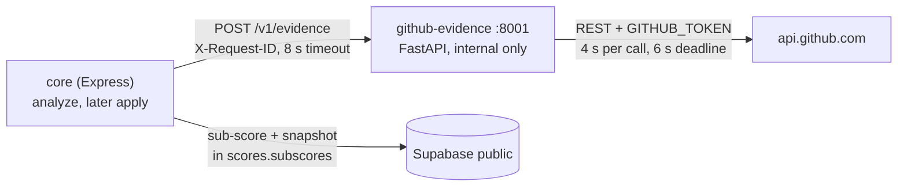
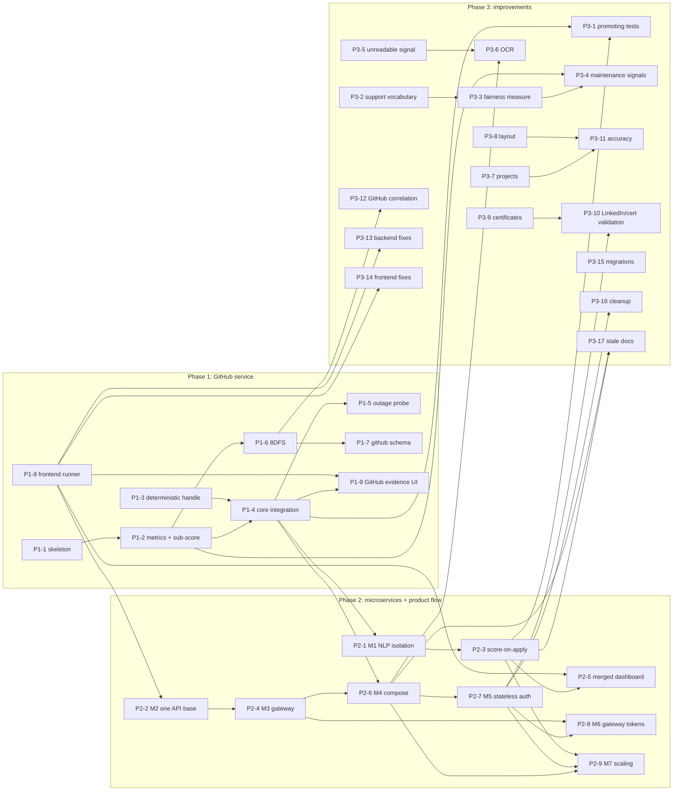

# ROADMAP.md: what we build next, and in what order

Written in T-0010 (2026-10-14), from AUDIT.md (verified at `2e87d44`),
ARCHITECTURE.md (DEC-1..DEC-6) and the open entries in ISSUES.md.

## How to read this

- **This is a plan, never a status report.** What exists, and in what condition, is
  in `AUDIT.md`. A "Moves" cell says which CHECKLIST ids an item is expected to
  change. The task that builds the item sets the real status, with evidence.
- **Item ids.** `P1-n`, `P2-n` and `P3-n` belong to this file. CHECKLIST ids (`2.12`,
  `GR-2`) and issue ids (`I-0015`) are defined in their own files.
- **Order.** Items are listed in a dependency-correct order. "Depends on" names only
  earlier items. Items with no dependency between them can run in parallel, on
  different teammates.
- **Size.**
  - **S**: up to one day, one session.
  - **M**: two to four days.
  - **L**: one to two weeks. Split it if it grows past that.
- **Status abbreviations in "Moves"**, from → expected:
  - `MIS` = MISSING;
  - `PART` = STUBBED_OR_PARTIAL;
  - `BROKEN` = DONE_BUT_BROKEN_OR_HACKY;
  - `CRU` = CODE_REVIEWED_UNTESTED;
  - `DONE` = DONE_CORRECTLY.

  An id with no arrow is touched but keeps its status.
- **Task.** The task spec that builds the item. `later` means no spec has been
  written yet. Each item gets its own spec and approval before any code.
- **Checked by** `node tests/docs/check-trackers.mjs` (the `docs` suite). It fails if:
  - an item depends on a later item;
  - a size is not S, M or L;
  - a CHECKLIST, issue or task id does not exist.

  It warns, without failing, when an open issue or a CODE_REVIEWED_UNTESTED row is
  not mapped to any item.

## Decisions this roadmap rests on

Owner decisions are recorded in ARCHITECTURE.md §4:
- **DEC-1, DEC-2:** a thin Node gateway, with forward-auth until token auth exists.
- **DEC-3:** stateless JWT auth as the target; its timing is set here, at P2-7.
- **DEC-4:** GitHub evidence and assessment are separate Python services.
- **DEC-5:** github-evidence is internal only. Core calls it; the browser never does.
- **DEC-6:** github-evidence starts stateless; its `github` schema arrives with 8DFS (P1-7).

Defaults set by this roadmap. The owner can change any of them in the review of
the task that applies it:
- **Service.** `github-evidence/` at the repo root: Python, FastAPI, httpx.
  - Port 8001 (ARCHITECTURE §4.1), its own venv, and every requirement pinned
    (the lesson of I-0038).
  - FastAPI's `/docs`, `/redoc` and `/openapi.json` are off, there is no CORS
    middleware, and it binds 127.0.0.1.
  - No internal auth token in v1, the same model as NLP: network isolation.
    Revisit for both services in P2-6 (I-0034).
- **Username source.** The parsed resume only.
  - `profiles.github_url` is never written: signup leaves it out and no UI field
    sets it. So there is no fallback code for it.
  - Explicit input arrives with GitHub OAuth, after P2-7 (see "Not scheduled").
  - Core turns the parsed link (`github.com/alice`) into a login (`alice`) and
    validates it against GitHub's login rules before any call.
- **Where the formula lives.** The GitHub sub-score formula lives in the service,
  as NLP computes its own match score. Core maps the result into the uniform
  sub-score shape and aggregates it (ARCHITECTURE AD-3).
- **Commit activity uses REST.** `/repos/{owner}/{repo}/commits?author=&since=`
  sees the default branch only; this is a stated limitation. GraphQL
  `contributionsCollection` is the option for GF-3 signals (P3-4).
- **Reachability.** GitHub evidence is scored through `POST /api/analyze`, which the
  UI does not reach (AUDIT 5.14). It becomes visible in the app once score-on-apply
  (P2-3) lands.

## Phase 1: GitHub validation module as a microservice

### 1.1 Shape



Flow inside core:
1. Analyze gets NLP's `entities.github`. P1-3 makes that value deterministic.
2. Core normalises it to a login.
3. Core calls `POST /v1/evidence` with the login and the parsed skills.
4. The response becomes the `github_evidence` sub-score.
5. `aggregate()` redistributes the weights over the available sources.

If anything fails, the sub-score is "unavailable" with a reason (§1.3), and the score
is still produced.

### 1.2 Contract v1 (core ↔ github-evidence)

T-0011 moves this section into `github-evidence/README.md` next to the code, and
replaces it here with a pointer.

**`GET /health`** → `200 {"status":"ok","service":"github-evidence","contract_version":"1","token_configured":true}`.
It makes no GitHub call.

**`POST /v1/evidence`**
- Request headers:
  - `Content-Type: application/json`;
  - `X-Request-ID`, optional.
- Request ID rules:
  - it is accepted only if it matches `^[A-Za-z0-9-]{1,64}$`; otherwise a UUID is
    generated;
  - it is echoed on the response and written in every log line for the request;
  - core forwards the ID it received or generated. Once the gateway exists (P2-4),
    the gateway generates it.
- Request body:

```json
{ "username": "octocat", "claimed_skills": ["python", "react", "docker"], "window_days": 365 }
```

- `200` body (abridged; P1-2 fills the metric fields):

```json
{
  "contract_version": "1",
  "request_id": "3f6c…",
  "username": "octocat",
  "status": "complete",
  "fetched_at": "2026-10-14T10:00:00Z",
  "profile": { "public_repos": 8, "html_url": "https://github.com/octocat" },
  "repositories": { "listed": 8, "owned": 6, "forked": 2, "archived": 0, "considered": 6, "truncated": false,
    "items": [ { "name": "hello-world", "fork": false, "pushed_at": "…", "primary_language": "Python",
                 "authored_commits_window": 12, "languages": { "Python": 12345 } } ] },
  "languages": [ { "name": "Python", "bytes": 12345, "share": 0.62 } ],
  "commit_activity": { "window_days": 365, "authored_commits": 120, "active_weeks": 30, "weeks": 52, "weekly": [0, 3, 1] },
  "claims": [ { "skill": "python", "language": "Python", "status": "evidenced", "share": 0.62, "repos": ["hello-world"],
                "last_activity": "2026-09-30T08:00:00Z" },
              { "skill": "react", "language": null, "status": "not_checkable" } ],
  "sub_score": { "available": true, "value": 0.64, "reason_code": null, "weights_source": "default",
    "components": [ { "key": "activity", "value": 0.7, "weight": 0.25, "available": true } ] },
  "limitations": ["public_repositories_only", "default_branch_only", "detail_repos_capped:10"],
  "rate_limit": { "remaining": 4780, "reset_at": "2026-10-14T11:00:00Z" }
}
```

- **`status: "partial"`** means some per-repo calls failed, or the 6 s deadline hit
  after the profile and repository list arrived. The sub-score is computed from what
  arrived, and `limitations` names what is missing (CHECKLIST 2.13).
- **Claim statuses:**
  - `evidenced`: any owned, non-fork repo uses the claimed language, at any age.
    `last_activity` (latest `pushed_at` among those repos) is reported per claim and
    does not change the status;
  - `not_found`: a checkable language that no owned, non-fork repo uses (never "too old");
  - `not_checkable`: frameworks and tools that language statistics cannot show.
    These are never counted against the candidate.
- **Errors** are always `{"error": "<code>", "message": "<fixed safe text>"}`. They
  never echo GitHub's body, the token or an internal URL (the lesson of I-0036).

| HTTP | `error` | When |
|---|---|---|
| 400 | `invalid_request` | Body or login fails validation; no GitHub call is made |
| 404 | `github_user_not_found` | GitHub answers 404 for the user |
| 503 | `github_rate_limited` | Primary or secondary limit, or below the low-water mark; carries `Retry-After` |
| 503 | `github_auth_failed` | GitHub rejects our token (a misconfiguration) |
| 502 | `github_upstream_error` | GitHub 5xx or connection errors after one retry, with nothing usable |
| 504 | `github_timeout` | The deadline passed before the profile and repository list arrived |

**Timeouts.** These are starting values; P1-5 measures them.
- Inside the service: 4 s per GitHub call and a 6 s deadline per request.
- Core → service: 8 s, longer than the deadline, so the service can still answer
  `partial`.
- Core → NLP: 15 s (ARCHITECTURE §4.8). Analyze is synchronous, so its worst case is
  15 s for NLP plus 8 s for GitHub, which is more than the gateway's 20 s.
- Recommendation: remove `/api/analyze` once score-on-apply scores asynchronously
  (decided in P2-3). If it stays, its gateway timeout must be at least 25 s.

**Environment variables (names only).**

| Where | Variable | Default | Meaning |
|---|---|---|---|
| service | `GITHUB_TOKEN` | none; the service refuses to start without it | Fine-grained personal access token with public read only. Lives only in the service's env (NFR-9) |
| service | `GITHUB_API_URL` | `https://api.github.com` | Tests and the probe point it at stubs |
| service | `GITHUB_MAX_REPOS` | 100 | Repositories listed (pagination stops here; `truncated` is set) |
| service | `GITHUB_DETAIL_REPOS` | 10 | Owned, non-fork repos (most recently pushed) that get per-repo language and commit calls |
| service | `GITHUB_CONCURRENCY` | 3 | Concurrent GitHub calls per request. GitHub advises serial requests; set 1 to follow that strictly |
| service | `GITHUB_HTTP_TIMEOUT_S` / `GITHUB_DEADLINE_S` | 4 / 6 | See timeouts |
| service | `GITHUB_MIN_REMAINING` | 100 | Low-water mark for the rate limit |
| service | `GITHUB_SUBSCORE_WEIGHTS` | documented in P1-2 | JSON override with the same fallback rules as `CREDIBILITY_WEIGHTS` |
| core | `GITHUB_EVIDENCE_URL` | `http://localhost:8001` | Empty means disabled, reason `service_disabled` |
| core | `GITHUB_EVIDENCE_TIMEOUT_MS` | 8000 | Core → service timeout |

### 1.3 GF-4: when the GitHub sub-score is unavailable

Each case below is stored with `available: false`, `value: null` (never 0), a
`reason`, and `components.reason_code`. `aggregate()` then renormalises the weights
over the other sources. With parsing alone, parsing's weight is 1.0.

| `reason_code` | Cause | Reason text (draft) |
|---|---|---|
| `no_github_link` | The resume has no GitHub link | No GitHub profile link was found on the resume, so GitHub evidence was not used. |
| `invalid_github_link` | The link does not yield a valid GitHub login | The GitHub link on the resume is not a valid profile address. |
| `github_user_not_found` | 404 from the service | The GitHub account named on the resume does not exist. |
| `no_public_repositories` | `sub_score.available: false` from the service | The GitHub account has no public repositories of its own to check. |
| `github_rate_limited` | 503 `github_rate_limited` | GitHub's request limit was reached, so repository activity was not checked for this score. |
| `service_unavailable` | Connection refused, or 502/503 other than a rate limit | The GitHub evidence service was not reachable, so repository activity was not checked. |
| `timeout` | No answer within `GITHUB_EVIDENCE_TIMEOUT_MS` | The GitHub evidence check took too long and was skipped for this score. |
| `service_error` | 400, 504, an unexpected status, or an invalid body | The GitHub evidence check failed, so repository activity was not checked. |
| `service_disabled` | `GITHUB_EVIDENCE_URL` is empty | Keeps today's text: "…The GitHub Aggregator service is not part of this deployment yet…" |

A "partial" response is still available, and its explanation lists the limitations.
"Public repositories only" always appears in the explanation, so private work is
never silently counted as missing (CHECKLIST 2.10).

### 1.4 Data: stateless first (DEC-6)

- **Phase 1 to P1-6.** The service stores nothing. Core persists the evidence snapshot
  in `scores.subscores.github_evidence.components`, an existing jsonb column, so no
  migration is needed. The snapshot holds:
  - the repository and language summary;
  - commit activity and the claims;
  - the request ID, `fetched_at` and `contract_version`.

  A recruiter's drill-down and a later re-explanation (4.11) read the stored
  snapshot and never call GitHub again. This covers what 2.11 asks for, but not the
  separate Repository entity, so 2.11 stays PART.
- **P1-7.** The `github` schema and the `github_svc` login role (ARCHITECTURE §4.5):
  - a `repositories` table (the SRS Repository entity) and an analysis cache keyed on
    each repo's head commit SHA, so 8DFS never re-analyses unchanged code;
  - stored ETags for conditional requests (a `304` does not count against the
    primary limit);
  - an idempotent migration (the rule from I-0010);
  - the schema is not exposed to the Data API; the service connects through the
    Supavisor session pooler;
  - a test proves `github_svc` gets "permission denied" on `public`.

  It comes after 8DFS because 8DFS is what makes caching worth it: about 9 extra
  calls per analysed repo.

### 1.5 GitHub rate limits

- **Budget.** With a token, the primary limit is 5,000 requests per hour. Calls per
  candidate:
  - 1 for the user and 1 or 2 for the repository list;
  - 2 per detail repo: languages and authored commits.

  That is about 22 calls, or about 220 candidates per hour on one token. 8DFS adds
  about 9 calls per analysed repo, which is why P1-7 adds the cache.
- **Tracking.** `x-ratelimit-remaining` and `x-ratelimit-reset` are read from every
  reply and kept in process.
- **Low-water mark.** Below `GITHUB_MIN_REMAINING`, the service answers 503 at once,
  without calling GitHub, and sets `Retry-After` to the reset time.
- **Primary limit hit** (403 or 429 with `x-ratelimit-remaining: 0`): no retry. 503
  with `Retry-After` = reset − now.
- **Secondary limit** (403 or 429 with a `retry-after` header): one retry, only if
  the wait is at most 1 s and fits the deadline; otherwise 503.
- **5xx and connection errors:** one retry with jitter, inside the deadline.
- **Every request carries** `Authorization: Bearer`, `X-GitHub-Api-Version:
  2022-11-28` and a `User-Agent`. The token is never logged.

### 1.6 Tests: recorded responses only, never the live API

- **Service tests** (pytest, `tests/github/`):
  - they run in process through FastAPI's `TestClient`, with no uvicorn and no port;
  - `respx` mocks httpx with `assert_all_mocked`, so an unexpected request fails;
  - `pytest-socket --disable-socket` turns any real network call into an error, so
    "never the live API" is enforced, not just intended.
- **Recordings** live in `tests/github/recordings/`, listed in a `manifest.json`:
  - `octocat` (GitHub's demo account) is recorded once by the owner with
    `github-evidence/tools/record_github.py` and their own token. Headers are
    allow-listed and the token is scrubbed; a test checks this.
  - **Synthetic** recordings cover the cases a real account cannot show on demand:
    Link-header pagination, primary and secondary limits, 404, 5xx and timeouts.
    They are marked `synthetic` in the manifest.
- **New `github` suite** in `tests/run-suite.ps1`. It uses its own venv
  (`github-evidence/venv`) and its own pytest call, because two `conftest.py` files
  in one run clash. It is skipped for `-Target baseline`, which has no such service.
- **Core tests** (`node:test`), the repo's first unit tests:
  - offline tests import `backend/Services/explainability.js` and the new client;
  - the client is tested against a local stub HTTP server, never the real service;
  - one `-Live` test runs a real analyze against a stub on :8001 that replays a
    recorded service response.
- **Outage probe:** `tests/arch/nlp-outage-probe.mjs` gains P-4 (service down),
  P-5 (service hung) and P-6 (GitHub rate-limited). P-6 points the real service at a
  stub GitHub. These rows assert, and the probe exits 1 when one fails. P-1..P-3 stay
  descriptive until P2-1.

### 1.7 Items

| Id | Item | Depends on | Size | Files | Moves | Issues | Task |
|---|---|---|---|---|---|---|---|
| P1-1 | Service skeleton: contract v1 (§1.2), GitHub client (token, pagination, rate limits §1.5, retry, deadline), username validation, request ID, recorded-response harness, `github` suite | — | M | `github-evidence/app/{main,config,contract,github_client}.py`, `github-evidence/{requirements.txt,requirements-dev.txt,README.md,.env.example}`, `github-evidence/tools/record_github.py`, `tests/github/{conftest.py,test_service.py,test_client.py,recordings/}`, `tests/run-suite.ps1`, `tests/README.md` | 2.3 PART (service half; DONE once P1-4 feeds the score); 2.13 BROKEN (service half) | — | T-0011 |
| P1-2 | Metrics and sub-score: 52-week authored-commit activity, language breakdown, owned vs forked, consistency, claim cross-reference against the parsed skills, documented formula and weights, partial labelling, call budget | P1-1 | M | `github-evidence/app/{metrics,claims,scoring,skill_languages}.py`, `github-evidence/README.md`, `tests/github/{test_metrics.py,test_scoring.py,snapshots/}`, `tests/github/recordings/` | 2.4 MIS (all but quality); 2.5 MIS; 2.7 MIS (all DONE once P1-4 feeds the score) | — | T-0012 |
| P1-3 | Deterministic contact fields in the parser: document order instead of `set()`; GitHub link prefers a bare profile URL; full path captured; trailing punctuation stripped. The `entities.github` output shape is unchanged | — | S | `nlp-engine/app/ner.py`, `tests/nlp/test_contact_determinism.py`, `tests/nlp/snapshots/current/` | 2.1 PART (resume path deterministic); 4.11 CRU (deterministic input) | I-0015, I-0043 | T-0013 |
| P1-4 | Core integration: `backend/Services/internalHttp.js` (timeout, one retry on connect errors, request ID, safe errors) and `githubEvidence.js` (login normalisation, reason codes §1.3); `buildScoreRecord(nlpJson, { github })` and `buildGithubSubScore`; per-skill `sources.github`; flags stay "not available" (no false "no contradictions"); "public repositories only" in the explanation; `githubAggregator.js` deleted | P1-2, P1-3 | L | `backend/Services/{internalHttp,githubEvidence,explainability}.js`, `backend/Controllers/analysis.controller.js`, `backend/.env.example`, `backend/Controllers/githubAggregator.js` (deleted), `tests/backend/{explainability.test.mjs,github-evidence-client.test.mjs,live-analyze-github.test.mjs,lib/stub-server.mjs}`, `tests/run-suite.ps1`, `AUDIT.md` | 2.3 PART→DONE; 2.4 MIS→PART; 2.5 MIS→DONE; 2.7 MIS→DONE; 2.8 PART (now exercised with two sources; assessment-only needs Module 3); 2.10 MIS→DONE; 2.11 MIS→PART; 2.12 MIS→DONE; 2.13 BROKEN→DONE; 4.1 BROKEN (2 of 3 sources); 4.2 PART→DONE; 4.5 PART; 4.7 CRU→DONE; 0.3 PART; 0.5 CRU (GitHub key server-side); 0.7 MIS→PART (GitHub path) | I-0039 (githubAggregator part) | T-0014 |
| P1-5 | Outage probe P-4 service down, P-5 service hung, P-6 GitHub rate-limited, as asserting rows; timings feed the §1.2 timeout values | P1-4 | S | `tests/arch/nlp-outage-probe.mjs`, `tests/README.md` | 0.7 PART (evidence); 2.8 PART (evidence); 2.13 DONE (evidence); GR-2 PART (evidence) | — | T-0015 |
| P1-6 | 8DFS (FR-7): up to 8 core logic files per analysed repo (top repos by authored commits); skips vendor, config, lock, generated, minified and test files; `lizard` for cyclomatic complexity, function length and parameter counts; smell flags; a quality component in the sub-score | P1-2 | L | `github-evidence/app/{dfs8,quality}.py`, `github-evidence/app/scoring.py`, `github-evidence/requirements.txt`, `tests/github/test_dfs8.py`, recordings of git trees and blobs | 2.6 MIS→DONE; 2.4 PART→DONE; 2.12 DONE | — | later |
| P1-7 | `github` schema and `github_svc` role (DEC-6): Repository entity, SHA-keyed analysis cache, ETags, cross-schema denial test, idempotent migration | P1-6 | M | `supabase/migrations/<date>_github_schema.sql`, `github-evidence/app/store.py`, `github-evidence/requirements.txt`, `tests/github/test_store.py` | 2.11 PART→DONE; 0.2 PART; 0.3 PART→DONE | — | later |
| P1-8 | Frontend test runner (`react-scripts test --watchAll=false` as a run-suite step) plus characterisation tests of today's recruiter pages, so every later frontend change runs under them | — | S | `frontend/package.json`, `tests/run-suite.ps1`, `tests/README.md`, `tests/frontend/{jobdetails-filters,evidence-limited,skill-evidence}.test.jsx` (location settled in the task: CRA's Jest only looks under `src/`), `AUDIT.md` | 5.6 CRU→DONE; 5.10 CRU→DONE; 5.11 CRU→DONE | — | later |
| P1-9 | Recruiter view of GitHub evidence: a GitHub column in the per-skill table, a repo drill-down (which repo, which metric), GitHub contradiction flags such as "claimed language absent from all repos" | P1-4, P1-8 | M | `backend/Services/explainability.js` (`buildFlags`), `frontend/src/components/recruiter/{ScoreBreakdown,CandidateModal}.jsx`, `tests/frontend/`, `tests/backend/explainability.test.mjs` | 4.6 MIS→PART; 5.7 PART; 5.8 PART; 5.9 PART | I-0040 | later |

### 1.8 FR-4..FR-7 coverage

| FR | Covered by | Left out, and why |
|---|---|---|
| FR-4 username from resume or user input | P1-3, P1-4 (resume) | User input: `profiles.github_url` is never written; it comes with GitHub OAuth after P2-7 |
| FR-5 repository data via the GitHub API | P1-1 | GraphQL: REST is enough for v1 (P3-4 may use it) |
| FR-6 repo count, commit frequency, code-quality indicators | P1-2 (counts, activity, ownership, consistency), P1-6 (quality) | — |
| FR-7 8DFS, 5-10 core files per repo | P1-6 | — |

## Phase 2: existing features as microservices, plus the agreed product flow

| Id | Item | Depends on | Size | Files | Moves | Issues | Task |
|---|---|---|---|---|---|---|---|
| P2-1 | M1 NLP failure isolation: core → NLP over `internalHttp` (15 s, one retry on connect errors), `503 {"error":"nlp_unavailable"}` with `Retry-After`, no raw text on any path; `/parse` becomes a plain `def`; probe P-1/P-2 assert | P1-4 | S | `backend/Controllers/analysis.controller.js`, `nlp-engine/app/main.py`, `tests/arch/nlp-outage-probe.mjs`, `tests/README.md` | 0.7 PART→DONE; GR-2 PART (evidence) | I-0036, I-0037 | later |
| P2-2 | M2 one API base: `src/config/api.js` (relative base), the CRA `proxy` in dev, the `window.fetch` patch removed, the 5 hardcoded calls fixed | P1-8 | S | `frontend/src/config/api.js` (new), the 14 files that declare `API_BASE_URL` (e.g. `frontend/src/context/AuthContext.jsx`, `frontend/src/pages/recruiter/CreateJob.jsx`, `frontend/src/pages/public/ResetPassword.jsx`), `frontend/package.json` | GR-2 PART (evidence) | I-0012 | later |
| P2-3 | Score-on-apply (5.14, R9): `scores.application_id` plus status and reason (idempotent migration); scoring extracted from `analyzeResume` into `backend/Services/scoring.js` (stored resume → NLP → GitHub → `buildScoreRecord`); apply returns 201 with the score "pending" and never waits for NLP (ARCHITECTURE §4.4); a DB-row claim and a boot-time re-queue of stale pendings, safe with two core replicas; the candidate sees pending, scored or failed with a reason; `Processing.jsx` deleted; `/api/analyze` removed or kept by decision | P2-1 | L | `supabase/migrations/<date>_score_on_apply.sql`, `backend/Services/scoring.js` (new), `backend/Controllers/{jobs,analysis}.controller.js`, `backend/index.js`, `frontend/src/pages/candidate/{JobDetail,Results}.jsx`, `frontend/src/pages/candidate/Processing.jsx` (deleted), `frontend/src/App.jsx`, `tests/backend/live-score-on-apply.test.mjs`, `tests/backend/lib/testdb.mjs` | 5.14 MIS→DONE; 5.4 PART→DONE; 0.8 MIS→PART | I-0034 (the analyze file-type half) | later |
| P2-4 | M3 API gateway (DEC-1, DEC-2): `gateway/` on :5000, core on :5001 with `trust proxy`; routing, forward-auth to `/api/auth/me` under the five constraints, rate limits and CORS moved out of core, `X-Request-ID`, aggregated `/health` | P2-2 | L | `gateway/{index.js,public-routes.js,package.json}` (new), `backend/index.js`, `backend/Routes/auth.routes.js`, `tests/gateway/*.test.mjs` (new), `tests/run-suite.ps1`, `tests/backend/lib/env.mjs`, `ARCHITECTURE.md` | GR-2 PART; 0.1 PART | I-0034 (NLP CORS half), I-0035 (rate-limiter half) | later |
| P2-5 | Merged application-centric recruiter dashboard (5.15, R38): one view per application with score or "pending", status, shortlist and reject, and the explanation drill-down; applicants appear whether scored or not; email source decided once (I-0028) | P2-3, P1-8 | L | `frontend/src/pages/recruiter/{Dashboard,JobDetails}.jsx`, `frontend/src/components/recruiter/{CandidateModal,ScoreBreakdown}.jsx`, `backend/Controllers/analysis.controller.js` (`getAllApplicants`), `backend/Routes/analysis.routes.js`, `tests/frontend/`, `tests/backend/live-applicants.test.mjs` | 5.15 PART→DONE; 5.5 PART→DONE; 5.7 PART; 5.8 PART | I-0028 | later |
| P2-6 | M4 containers and one-command start: Dockerfiles for gateway (with the frontend build), core, nlp and github-evidence; `docker-compose.yml` and `docker-compose.test.yml` (ARCHITECTURE §4.7); pinned NLP requirements and one venv; the checker learns `.yml` cites | P2-4, P1-4 | M | `gateway/Dockerfile`, `backend/Dockerfile`, `nlp-engine/Dockerfile`, `github-evidence/Dockerfile`, `docker-compose.yml`, `docker-compose.test.yml`, `nlp-engine/requirements.txt`, `tests/run-suite.ps1`, `tests/docs/check-trackers.mjs`, `README.md` (run section) | GR-2 PART→DONE (AUDIT's promote rule); 0.1 PART | I-0038, I-0034 (NLP internal only), I-0042, I-0032 (run section) | later |
| P2-7 | M5 stateless auth (DEC-3): Supabase access and refresh tokens in httpOnly cookies; `express-session` removed; single-flight refresh in the frontend; logout revokes. **Timing: after M4, before M6 and M7** | P2-6 | L | `backend/Controllers/auth.controller.js`, `backend/Middlewares/auth.Middleware.js`, `backend/index.js`, `backend/Routes/auth.routes.js`, `frontend/src/context/AuthContext.jsx`, `tests/backend/lib/session.mjs`, `tests/backend/live-auth-failclosed.test.mjs` | 0.4 BROKEN (stateless; OAuth now possible) | I-0035 | later |
| P2-8 | M6 the gateway verifies tokens locally (`jose`, JWKS or HS256), strips client `X-User-*`, and replaces DEC-2's forward-auth | P2-4, P2-7 | M | `gateway/auth.js` (new), `gateway/index.js`, `tests/gateway/` | 0.4 BROKEN; GR-2 DONE (evidence) | — | later |
| P2-9 | M7 scaling and load evidence: `--scale core=2 --scale nlp=2` passes the harness; autocannon at 100 connections through the gateway; the P2-3 claim holds with two replicas | P2-6, P2-7, P2-3 | M | `tests/load/` (new), `docker-compose.yml`, `tests/README.md` | 6.6 MIS→DONE; 0.8 PART; 0.1 PART (2 of 3 Python services) | — | later |

### Order, tracks and DEC-3

Two tracks. They can run in parallel on different teammates once P2-1 is done:
- **Architecture:** P2-1 → P2-2 → P2-4 → P2-6 → P2-7 → P2-8 → P2-9.
  GR-2's minimum (M1–M4) is complete at P2-6.
- **Product:** P2-1 → P2-3 → P2-5.
  Score-on-apply and the merged dashboard. After P2-3, the GitHub sub-score from
  Phase 1 shows in the app.

Why this order:
- **P2-1 first.** Both tracks need it. A background scorer must never hang on NLP,
  and it reuses Phase 1's `internalHttp`.
- **P2-2 after P1-8.** M2 touches 14 frontend files, and P1-8's tests must already be
  in place when it does.
- **P2-5 after P1-8.** Its characterisation tests are the regression net for the merge.
- **DEC-3: M5 (P2-7) comes after M4 (P2-6).**
  - GR-2's minimum doesn't need it: forward-auth (DEC-2) works with sessions.
  - Doing it after the containers exist tests cookies, refresh and `trust proxy`
    once, against the real stack.
  - M6 (P2-8), the scaling evidence (P2-9) and every OAuth item (GitHub connect,
    LinkedIn sign-in) need it, so it cannot slip past them.

## Phase 3: improvements to the built modules

| Id | Item | Depends on | Size | Files | Moves | Issues | Task |
|---|---|---|---|---|---|---|---|
| P3-1 | The remaining promoting tests (see "Test backlog"): secrets hygiene, scope guard, explainability weights and determinism, bias-free candidate keys on the apply-scoring path | P1-4, P2-3 | S | `tests/backend/secrets-hygiene.test.mjs`, `tests/docs/scope-guard.test.mjs`, `tests/backend/explainability.test.mjs`, `tests/backend/live-score-on-apply.test.mjs`, `tests/run-suite.ps1`, `AUDIT.md` | 0.5 CRU→DONE; 0.9 CRU→DONE; 4.3 CRU→DONE; 4.11 CRU→DONE; 5.12 CRU→DONE | — | later |
| P3-2 | Support and maintenance vocabulary (ITSM, ticketing, monitoring, directory services, shell, PL/SQL…); remove invented and duplicate keywords; drop the "github"-as-a-skill false positive | — | S | `nlp-engine/app/ner.py`, `tests/nlp/snapshots/current/` | 1.17 MIS→DONE | I-0004 | later |
| P3-3 | GF-3 fairness measure: paired fixtures (a support candidate on a support JD vs a developer on a dev JD); a test that fails when the support pair scores lower beyond a stated tolerance; the result recorded | P3-2 | M | `tests/fixtures/{make_fixtures.py,manifest.json,jds/}`, `tests/nlp/test_fairness.py` (new), `tests/FAIRNESS.md` (new) | 4.12 MIS→DONE; 4.8 MIS→PART | — | later |
| P3-4 | GitHub maintenance signals (2.9): commits to forks and others' repos, merged PRs, reviews and issues, as a sub-score component, so maintainers are not scored only on greenfield authorship | P1-2, P3-3 | M | `github-evidence/app/{metrics,scoring}.py`, `tests/github/`, recordings | 2.9 MIS→DONE; 4.8 PART→DONE | — | later |
| P3-5 | Unreadable input is signalled: no text layer or empty text → status `unreadable`, and the parsing sub-score is unavailable with a reason, not 0.0 | — | S | `nlp-engine/app/{main,extractor}.py`, `backend/Services/explainability.js`, `tests/nlp/test_parse.py` | 1.15 MIS→DONE | — | later |
| P3-6 | OCR (GF-2): pages with no text layer are rendered and OCR'd (Tesseract), then go through the same pipeline; f6 yields entities; latency benchmarked including OCR | P3-5, P2-6 | L | `nlp-engine/app/{ocr,extractor}.py`, `nlp-engine/requirements.txt`, `nlp-engine/Dockerfile`, `tests/nlp/test_ocr.py` | 1.2 MIS→DONE; 1.13 PART→DONE; 6.3 PART→DONE | — | later |
| P3-7 | Projects and portfolio links: the projects section is extracted (empty in all fixtures today); portfolio URLs; the NLP service emits its contract version | — | M | `nlp-engine/app/{ner,main}.py`, `tests/fixtures/make_fixtures.py`, `tests/nlp/` | 1.5 BROKEN (projects part); 1.9 PART→DONE; 1.10 PART→DONE | — | later |
| P3-8 | Layout: multi-column PDFs (word positions, column detection; fixture f5) and DOCX tables | — | M | `nlp-engine/app/extractor.py`, `tests/fixtures/`, `tests/nlp/` | 1.3 BROKEN→DONE; 1.8 PART→DONE; 1.1 DONE | — | later |
| P3-9 | Certificates and LinkedIn as structured entities: name, issuer, credential id and URL; persisted with the resume | — | M | `nlp-engine/app/{ner,main}.py`, `supabase/migrations/<date>_resume_certificates.sql`, `backend/Services/scoring.js`, `tests/nlp/` | 1.16 PART→DONE | — | later |
| P3-10 | LinkedIn and certificate validation: a spike (S) re-checks provider terms first, then builds the feasible part (see the feasibility section) | P3-9, P2-7 | L | spike note under `Docs/`, then per-issuer verifiers (location set by the spike), `backend/Services/explainability.js`, `frontend/src/components/recruiter/ScoreBreakdown.jsx` | 4.10 MIS→PART; 5.13 MIS→PART | — | later |
| P3-11 | Parser accuracy measured on a labelled sample (extraction accuracy, skill F1) | P3-7, P3-8 | L | `tests/eval/` (new), labelled data (real CVs under `tests/private/`, gitignored) | 1.11 MIS→DONE; 1.12 MIS→DONE; 6.1 MIS→DONE; 6.2 MIS→DONE | — | later |
| P3-12 | GitHub evidence vs human judgement: correlation on rated profiles (target ≥ 0.7, framed as correlation, not accuracy); calibrates the P1-2 weights | P1-6 | M | `tests/eval/github/` (new), `github-evidence/README.md` | 6.4 MIS→DONE | — | later |
| P3-13 | Backend small fixes: one-word names at signup, the duplicate profile insert, upload size limit with 413, the 404 message method, 400 for a malformed application id | P1-8 | S | `backend/Controllers/{auth,analysis,jobs}.controller.js`, `backend/index.js`, `frontend/src/pages/public/Login.jsx`, `tests/backend/` | — | I-0016, I-0017, I-0025, I-0027, I-0029 | later |
| P3-14 | Frontend small fixes: validate the file type on selection, label the Landing demo score "Example" and drop the fake stats, delete the unrouted `Assessment.jsx` shell (Module 3 builds its own UI after GR-1) | P1-8 | S | `frontend/src/pages/candidate/Upload.jsx`, `frontend/src/pages/public/Landing.jsx`, `frontend/src/pages/candidate/Assessment.jsx` (deleted), `tests/frontend/` | 5.1 PART | I-0005, I-0006, I-0026 | later |
| P3-15 | Migrations hygiene: every migration idempotent so the Supabase Preview check goes green; the bucket MIME allow-list and 10 MB cap in a migration; the stale `scores.subscores` comment | — | M | `supabase/migrations/*.sql` | 0.2 PART | I-0001, I-0010, I-0041 | later |
| P3-16 | Cleanup: unused `bcrypt`, empty middleware files, tracked `dev/null`, the empty `backend/uploads/`; the OAuth env vars are kept or removed once P2-7 settles OAuth | P2-7 | S | `backend/package.json`, `backend/Middlewares/{authCand,authRec}.Middleware.js`, `dev/null` | — | I-0039 | later |
| P3-17 | Stale docs, rewritten once, at the end, from AUDIT.md and ARCHITECTURE.md: CODE_MAP, README, REVIEW_BRIEF, and the owner's call on the SRS excerpt | P2-3, P2-6 | M | `CODE_MAP.md`, `README.md`, `REVIEW_BRIEF.md`, `PROJECT_SOURCE_DOCS.md` (only if the owner decides) | — | I-0030, I-0031, I-0032, I-0033 | later |

### Test backlog: the 9 CODE_REVIEWED_UNTESTED rows

The runner comes first, at P1-8, just before the first task that changes frontend
pages (owner, T-0010). Each test is the one AUDIT names in that row's "Promote with".

| AUDIT row | Promoting test | Item |
|---|---|---|
| 4.7 weight redistribution | `tests/backend/explainability.test.mjs`: parsing alone → weight 1.0; parsing + GitHub renormalise to 0.40/0.75 and 0.35/0.75; `evidence_limited` | P1-4 (Phase 1 needs it for GF-4) |
| 5.6 filters | `tests/frontend/jobdetails-filters.test.jsx` | P1-8 |
| 5.10 evidence-limited display | `tests/frontend/evidence-limited.test.jsx` | P1-8 |
| 5.11 per-skill badges | `tests/frontend/skill-evidence.test.jsx` | P1-8 |
| 0.5 secrets server-side | `tests/backend/secrets-hygiene.test.mjs` | P3-1 |
| 0.9 scope discipline | `tests/docs/scope-guard.test.mjs` | P3-1 |
| 4.3 weights | `tests/backend/explainability.test.mjs` (defaults, `CREDIBILITY_WEIGHTS` override, fallbacks) | P3-1 |
| 4.11 determinism | `tests/backend/explainability.test.mjs` (same input → same record apart from `generated_at`) | P3-1 |
| 5.12 bias-free keys | live test on the scoring path; it moves to the apply path if P2-3 removes `/api/analyze` | P3-1 |

### LinkedIn and certificates (GF-1): an honest feasibility assessment

This is from what we know as of October 2026. P3-10's spike re-checks it before
anything is built.
- **LinkedIn profile data: not feasible.**
  - LinkedIn offers no public API that lets a third party read a member's positions,
    skills or endorsements. Those APIs are limited to approved partners.
  - Scraping profiles breaks LinkedIn's User Agreement. We will not do it.
- **LinkedIn ownership: weakly feasible.**
  - "Sign In with LinkedIn using OpenID Connect" returns only name, email and picture.
    Supabase Auth offers it as a provider once P2-7 exists.
  - It can show that the candidate controls a LinkedIn account whose name matches
    the resume. It cannot show that what the resume claims is on that profile.
  - The recruiter view would label it "account linked, content not verified".
- **Certificates: partly feasible.**
  - A certificate can be verified only when its issuer publishes a verification URL
    or an Open Badges assertion: Credly, Accredible, and vendor programmes that issue
    through them.
  - P3-10 builds one verifier per supported issuer: fetch the public credential and
    compare name, title and date.
  - Everything else is shown as "claimed, not verified" and adds nothing to the score.
- **Consequence for 4.10 and 5.13:** they can reach PART, not DONE, unless the guide
  accepts "ownership plus issuer-verified certificates" as the meaning of GF-1. That
  is a question for the guide review.

## Not scheduled

These are not in the three phases. Each is listed with what it waits for.

| What | CHECKLIST ids | Waits for |
|---|---|---|
| Assessment module (PFQS, rubrics, LLM service with its own schema, M9) | 3.1–3.13, GR-1, 5.3, 6.5 | GR-1: the anti-cheat design must be written before Module 3 is built. Owners per DEC-4. P2-4 gives it a gateway route |
| GitHub OAuth connect and explicit username input | 2.1 (input path), 2.2, 5.2 | P2-7 (Supabase's GitHub provider needs token auth); it reuses P1-4 |
| Trained NER model, preprocessing that feeds NER, true hybrid layering | 1.4, 1.5, 1.7, 6.8 | P3-11's measurement, to show where model work pays off |
| TLS | 0.6 | P2-6 (Caddy or the gateway, ARCHITECTURE §5 "later") |
| Uptime monitoring | 6.7 | P2-6 |
| Recruiter audit log, code-originality signals | X-1, X-2 | Team proposals, not spec items; reconsider after Phase 2 |

## Open questions for the owner and the team

1. **DEC-4 owners.** github-evidence (Phase 1): the owner builds it (2026-10-15). Still open:
   who builds the assessment service later.
2. **GitHub token.** The owner creates a fine-grained token (public read only) for
   recording and local runs. It goes into `github-evidence/.env` and is never committed.
3. **Recorded account.** `octocat` by default. A teammate's real account would need
   their consent, because the recording is committed.
4. **`/api/analyze`.** Remove it once P2-3 lands (recommended, §1.2), or keep it.
   Decided in P2-3's spec.
5. **GF-1 scope.** Does the guide accept "ownership plus issuer-verified
   certificates" (see the feasibility section)?
6. **I-0033.** Keep the SRS excerpt verbatim (AD-1 records the deviation), or edit it.
   Decided in P3-17.

## Dependency graph

Arrows point from a prerequisite to the item that needs it.


